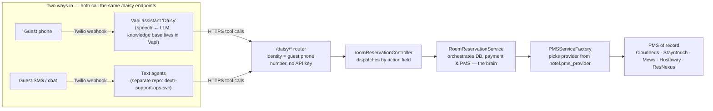
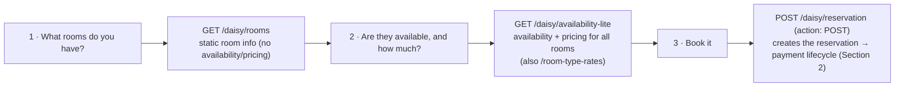
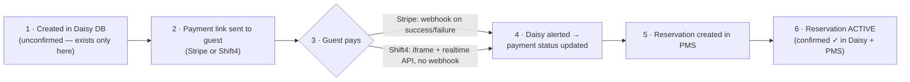
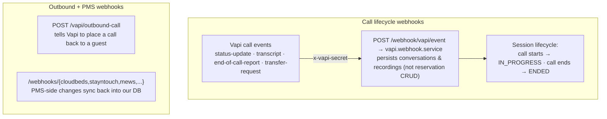
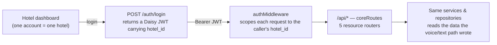
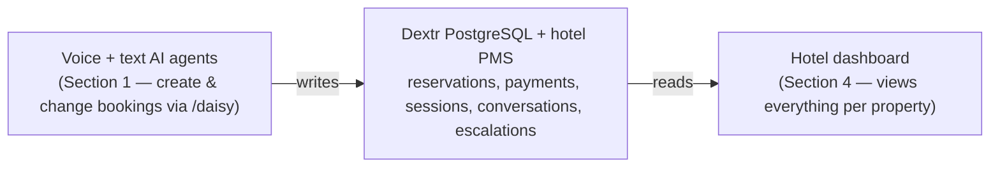

# Daisy Architecture — Voice, Text, Reservations & Dashboard

Daisy is an AI agent for hotels. A guest **phones or texts** in and books, changes,
cancels, or checks a reservation through Daisy; hotel staff watch every conversation,
booking, and payment from a web dashboard.

Both worlds are served by one Node/TypeScript service — the repo confusingly named
`websocket-server`, which is in fact a **plain REST/Express app** (see the naming note
at the bottom).

> **Daisy vs Danny.** The agent is called **Danny** when it uses a male voice and **Daisy**
> otherwise. It's the same agent hitting the same backend — the name is purely cosmetic and
> carries no behavioural difference. This doc says "Daisy" throughout to mean either.

The core mental model: **the voice/text path _writes_ data and the dashboard _reads_ it**,
through the same service layer and the same PostgreSQL database.

---

## 1. Voice & Text → Daisy → Reservation CRUD

Two front-ends — a Vapi **voice** agent and the **text** agents in `dextr-support-ops-svc`
— both arrive over **Twilio webhooks** and call the same `/daisy` HTTP endpoints like tools.
Neither touches the database directly; they ask this service to do the work.

### The guest booking journey — read before write

A guest doesn't jump straight to a reservation. Daisy walks them through it, and each step is
a separate tool call to `/daisy`: first **what rooms exist**, then **are they available and at
what price**, and only then **create the reservation**.

The first two steps are **read-only** — they don't create anything. The reservation only
comes into existence at step 3, and even then it isn't confirmed until payment clears (Section 2).

### The action dispatch — one endpoint, four verbs

Once the guest decides to book (or later wants to change/cancel/check a booking), everything
goes through a single endpoint. `POST /daisy/reservation` → `switchReservationBasedOnAction()`:

| `action` | Meaning              |
|----------|----------------------|
| `GET`    | fetch details        |
| `POST`   | create               |
| `UPDATE` | modify dates / room  |
| `CANCEL` | cancel booking       |

The read-only availability/info siblings used earlier in the journey are `/daisy/rooms`,
`/daisy/availability-lite`, and `/daisy/room-type-rates`. Multi-room bookings use
`/daisy/multi-reservation`.

---

## 2. Reservation & Payment Lifecycle — how a booking becomes *confirmed*

A created reservation is **not** a confirmed one. The PMS write happens only **after**
payment clears — not at creation. Until the final step, the reservation exists **only in
Daisy and is not confirmed** — it has not yet been written to the hotel's PMS.

**Payment providers differ in how Daisy learns the payment happened:**

- **Stripe — webhook-driven.** Guest pays via a Stripe checkout link; Stripe fires a
  **webhook** on success/failure; Daisy reacts to the webhook to complete step 4.
- **Shift4 — realtime, no webhook.** A payment **iframe is embedded in our own site**;
  we call Shift4 **APIs in realtime** to charge; the result returns on the API call.

---

## 3. Webhooks, Session Lifecycle & Sibling Services

Reservation CRUD is one channel (tool calls to `/daisy`). Vapi also drives call-lifecycle
events, and PMS providers call **back** into us via webhooks.

- A **session** row is created when a call begins (`IN_PROGRESS`) and updated to `ENDED`
  on the end-of-call report.
- Reservations are **dual-written**: they live in both the Dextr DB and the hotel's PMS
  (after confirmation), and PMS webhooks sync provider-side changes back in.

### PMS webhooks

Every PMS **except ResNexus** supports webhooks — the provider calls us when something changes
on their side (a cancellation, a date change, etc.).

- They are consumed **mainly by `alfred-core-svc`** (a separate repo that owns the
  post-reservation guest experience — see below).
- **Daisy also consumes PMS webhooks as needed.** For example, when a reservation is **cancelled
  in Cloudbeds**, Daisy is alerted and updates that reservation's status in its own DB, so the two
  stay in sync.

### Alfred — the concierge sibling (`alfred-core-svc`)

Alfred is primarily an **AI concierge** for the **post-reservation** guest experience, and lives
in a separate repo (`alfred-core-svc`). Guests chat with Alfred to make requests, raise
escalations and complaints, share preferences, and buy **upsell items** — early check-in, late
check-out, and property-specific add-ons — as well as make **do-not-disturb (DND)** requests.
Alfred can also send **scheduled messages** to guests and **collect feedback**.

Where Daisy is about *getting the booking made* (pre-stay), Alfred is about *the stay itself*
(post-booking) — and it's the primary consumer of the PMS webhooks above.

---

## 4. The Hotel Dashboard → `/api`

Every property has its own dashboard account. Staff log in and see all the data Daisy
generated for their hotel — calls, bookings, payments, escalations. It's **pure REST over
`/api`**; despite the repo name there is **no websocket to the browser** (the SMS inbox
simply polls).

### How a dashboard account is bound to one property

A dashboard user is a `User` row with a `role` and a `hotel_id`. On login that `hotel_id`
is baked into the JWT, and `authMiddleware` refuses any request where
`user.hotel_id ≠ token.hotel_id` — so a hotel only ever sees its own data. `SUPERADMIN`
is the exception and spans all properties.

Selected onboarded routes also accept an external **Core JWT** (SSO), validated against
remote JWKS; the property is then resolved from the token's `businessEnts` claim. If Core
auth fails, it falls back to the Daisy JWT.

### What the dashboard reads from `/api`

| Route               | Data shown |
|---------------------|------------|
| `/api/sessions`     | Call & chat history, transcripts, intents, KPI summaries + trends, SMS inbox |
| `/api/reservations` | Booking lists & detail, payment summary, manual charge / refund / auto-charge |
| `/api/payments`     | Payment lookup by id |
| `/api/escalations`  | Escalations raised on calls — list, detail, resolve |
| `/api/hotel`        | Hotel + configuration CRUD, VAPI recording backfill to S3 |

---

## 5. The Shared Spine

---

## 6. Where to Look in the Code

| Concept          | File(s)                                                          | What it does |
|------------------|-----------------------------------------------------------------|--------------|
| Route map        | `src/router/index.ts`                                            | Every mount point + which middleware guards it |
| Voice/text tools | `src/router/roomReservationRouter.ts`                           | The `/daisy/*` endpoints agents call as tools |
| Action dispatch  | `src/controller/roomReservationController.ts`                   | `switchReservationBasedOnAction` → GET/POST/UPDATE/CANCEL |
| Orchestration    | `src/services/roomReservation/roomReservationService.ts`       | DB dual-write, payment & PMS calls; core of CRUD |
| PMS abstraction  | `src/pms/PMSServiceFactory.ts` · `src/pms/types/IPMSReservationService.ts` | One interface, five provider implementations |
| Call lifecycle   | `src/services/vapi/webhook/vapi.webhook.service.ts`            | Handles `/webhook/vapi/event` — sessions, transcripts, recordings |
| Dashboard API    | `src/router/api/coreRoutes.ts`                                  | Mounts hotel · sessions · reservations · payments · escalations |
| Auth & scoping   | `src/middleware/authMiddleware.ts` · `src/services/auth/authService.ts` | Daisy JWT + Core JWT; `hotel_id` isolation |
| Text agents      | *separate repo* — `dextr-support-ops-svc`                       | SMS/chat AI; calls the same `/daisy` endpoints — not in this codebase |
| Alfred           | *separate repo* — `alfred-core-svc`                             | Post-reservation AI concierge; primary consumer of PMS webhooks — not in this codebase |

---

## 7. Environments, Consoles & Test Resources

Quick reference for finding your way around the running system.

### Consoles

| What | URL |
|------|-----|
| Dashboard — **production** | `https://dashboard.dextr.ai` |
| Dashboard — **dev** | `https://dashboard.dev.dextr.ai` |
| Vapi (voice agent config) | `https://dashboard.vapi.ai` |
| Twilio (numbers & webhooks) | `https://console.twilio.com` |

### Test calling numbers (Google Voice)

We keep two Google Voice numbers for **placing test calls** into a property. When you want to
test a property, you call its Twilio number from one of these:

| Google Voice number | Linked account |
|---------------------|----------------|
| `+1 408 320 5093` | `devops.dextr.ai` |
| `+1 408 404 8097` | `no-reply@dextr.ai` |

### Property phone numbers

**Each property has its own phone number**, purchased or ported into **Twilio**. That number's
inbound webhook is what routes a guest's call/text into Daisy (see Section 1). So "a property" in the
running system = a hotel record + its dedicated Twilio number.

### PMS coverage in dev

For **each PMS** (Cloudbeds, Stayntouch, Mews, Hostaway, ResNexus) we have **test properties set
up in the dev environment**, so every provider integration can be exercised end-to-end against
`dashboard.dev.dextr.ai` without touching production.

---

## Naming trap — why "websocket-server"?

The directory is called `websocket-server` but exposes **no** websockets today. The name is a
leftover from an earlier iteration:

1. The team started by **forking a GitHub repo** that built an in-house voice agent on the
   **OpenAI Realtime API**.
2. The OpenAI Realtime API is a **WebSocket-based protocol** — the client holds a persistent
   WebSocket to stream audio in and out — so that forked project genuinely was a websocket
   server, and the name fit.
3. The team later **discovered Vapi** and moved the voice stack onto it, dropping the OpenAI
   Realtime integration entirely — but **never renamed the repo**.

So the "websocket" in the name refers to a retired OpenAI Realtime implementation. Today it's
a plain **REST/Express** app that Vapi reaches over ordinary HTTPS.
