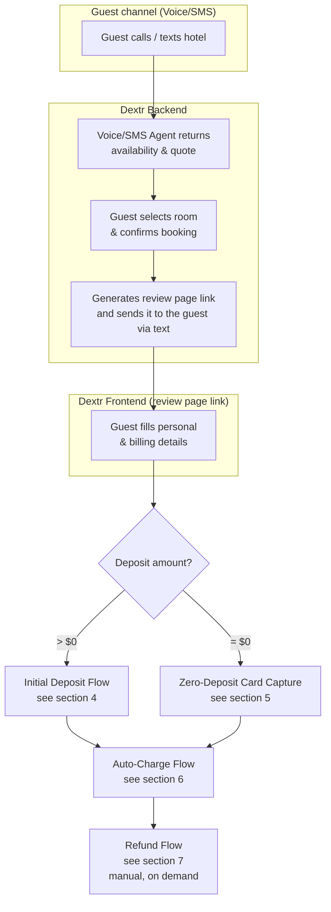
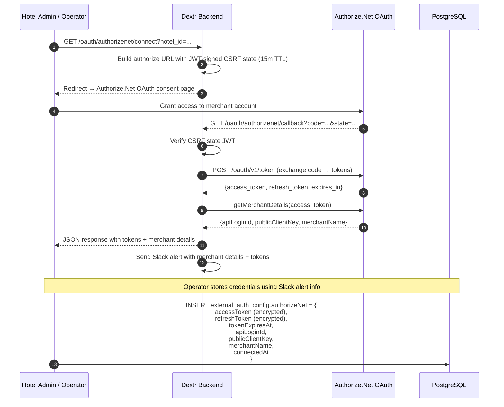
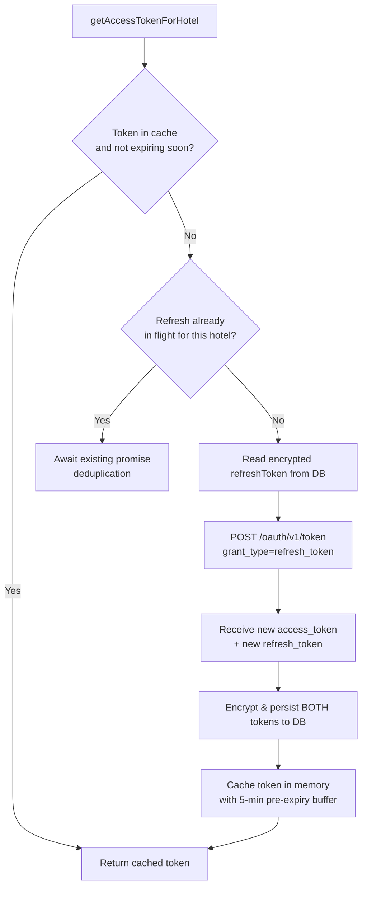
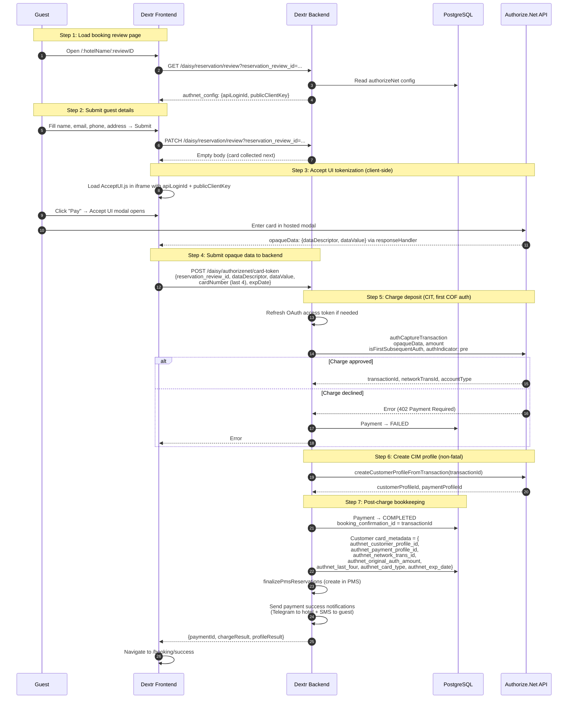
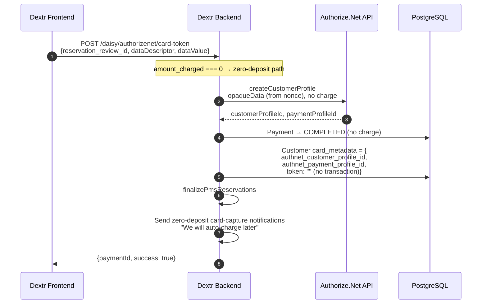
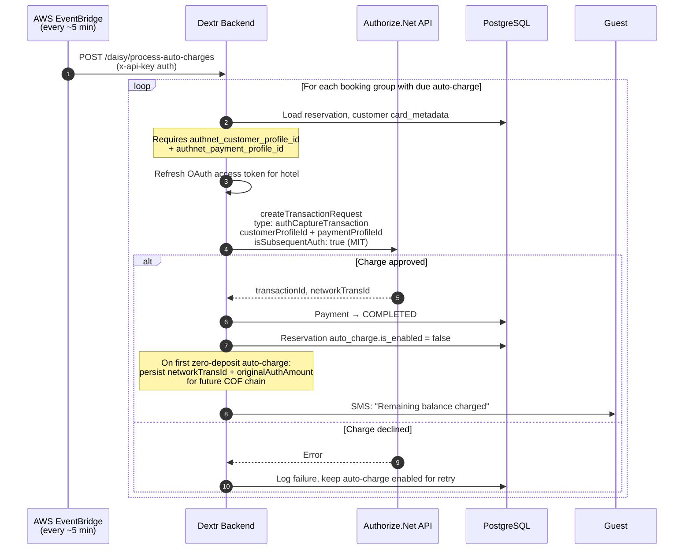
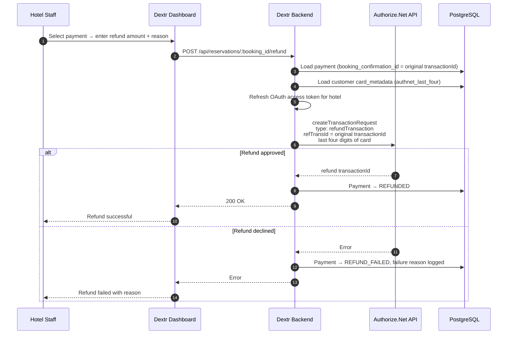

# Dextr × Authorize.Net Payment Integration Flow

This document describes how Dextr's Daisy Voice Agent platform integrates with
**Authorize.Net** for (1) initial deposit collection at booking time,
(2) zero-deposit card-on-file capture, (3) delayed auto-charges for remaining
balances, and (4) refunds initiated from the Dextr dashboard.

Authorize.Net uses **Accept UI** (a hosted payment modal powered by AcceptUI.js)
for PCI-compliant client-side card tokenization and **CIM (Customer Information
Manager)** profiles for storing card-on-file data used in subsequent
merchant-initiated auto-charges.

Legend:
- **Dextr Voice Agent** – AI agent that speaks/texts with the guest.
- **Dextr Backend** – Node.js service (`daisy-voice-agent-svc`).
- **Dextr Frontend** – Guest-facing web form (`dextr-public`) that hosts the Accept UI iframe (branch `feat/authnet-acceptui-payment`).
- **Dextr Dashboard** – Internal web app used by hotel staff.
- **Authorize.Net** – Payment gateway (Accept UI tokenization + Transaction API + CIM profiles).

External references:
- [Accept UI Guide](https://developer.authorize.net/api/reference/features/accept_hosted.html)
- [Accept.js Developer Guide](https://developer.authorize.net/api/reference/features/acceptjs.html)
- [Authorize.Net Transaction API](https://developer.authorize.net/api/reference/index.html)
- [CIM (Customer Profiles)](https://developer.authorize.net/api/reference/features/customer_profiles.html)
- [OAuth for Authorize.Net](https://developer.authorize.net/api/reference/features/oauth.html)
- [Card-on-File Compliance](https://developer.authorize.net/api/reference/features/card-on-file.html)

---

## 1. End-to-end overview



### How Authorize.Net differs from other providers

| Aspect | Stripe | Shift4 | Cloudbeds SDK | Authorize.Net |
|--------|--------|--------|---------------|---------------|
| Card tokenization | Stripe Elements | i4Go iframe | Cloudbeds Payment Element | Accept UI hosted modal (`opaqueData`) |
| Who charges | Dextr | Dextr | Cloudbeds | Dextr |
| Auto-charge | Stripe webhook | Shift4 API (scheduler) | Cloudbeds manages | Authorize.Net CIM (scheduler) |
| Auth model | API key per hotel | `authToken` → `accessToken` per hotel | HMAC-signed SDK key | OAuth per hotel (rotating refresh) |
| Card-on-file storage | Stripe customer ID | Shift4 `i4go_uniqueid` + `transactionId` | Cloudbeds manages | CIM `customerProfileId` + `paymentProfileId` |
| Refunds | Dextr → Stripe API | Dextr → Shift4 API | Manual (Cloudbeds dashboard) | Dextr → Authorize.Net API |
| 3DS handling | Stripe handles internally | i4Go 3DS plugin | Cloudbeds SDK handles | Not currently implemented |

---

## 2. Credential provisioning (OAuth connect — one-time per hotel)

Authorize.Net uses **OAuth** for per-hotel authentication. A single Dextr
OAuth app connects to multiple hotel merchant accounts. The OAuth flow
returns tokens + merchant details needed for Accept UI.

On successful callback, a **Slack alert** is sent to `DEXTR_SLACK_WEBHOOK_URL`
with the merchant details and tokens. An operator must then store the
credentials in the database for the matching hotel.

Code references:
- `websocket-server/src/authorizeNet/services/AuthorizeNetOAuthService.ts` – OAuth URL + code exchange
- `websocket-server/src/authorizeNet/services/merchantDetailsClient.ts` – fetches `apiLoginId` + `publicClientKey`
- `websocket-server/src/oauth/providers/AuthorizeNetOAuthProvider.ts` – OAuth provider adapter
- `websocket-server/src/router/oauthRouter.ts` – `/oauth/:provider/connect` + `/callback`



### What gets stored in the database

| Column | Field | Value | Encrypted? |
|--------|-------|-------|------------|
| `external_auth_config` | `authorizeNet.accessToken` | OAuth access token | Yes (AES-256-GCM) |
| `external_auth_config` | `authorizeNet.refreshToken` | OAuth refresh token (rotates on each use) | Yes (AES-256-GCM) |
| `external_auth_config` | `authorizeNet.tokenExpiresAt` | ISO timestamp of expiry | No |
| `external_auth_config` | `authorizeNet.apiLoginId` | Merchant API Login ID (for Accept UI) | No |
| `external_auth_config` | `authorizeNet.publicClientKey` | Accept UI public client key | No |
| `external_auth_config` | `authorizeNet.merchantName` | Merchant display name | No |
| `external_auth_config` | `authorizeNet.connectedAt` | ISO timestamp of connection | No |
| `hotels` | `payment_provider` | `authorize_net` | No |

---

## 3. Token management (automatic OAuth refresh)

Authorize.Net OAuth access tokens expire. The `AuthorizeNetTokenService`
automatically refreshes tokens before they expire and **always rotates the
refresh token** — the new refresh token must be persisted immediately.

Code reference:
- `websocket-server/src/authorizeNet/services/AuthorizeNetTokenService.ts`



Key behaviors:
- **In-memory cache** with 5-minute pre-expiry buffer — avoids hitting the DB/API on every request
- **In-flight deduplication** — concurrent calls for the same hotel share one refresh promise
- **Always rotates** — Authorize.Net issues a new `refresh_token` on every exchange; the old one is invalidated
- **Immediate persistence** — new tokens are written to the DB before returning the access token

---

## 4. Initial deposit flow (charge with nonce)

Triggered when `amount_charged > 0`. The guest's card is tokenized by
Accept UI into opaque data (`dataDescriptor` + `dataValue`), which the
backend uses to charge the deposit and create a CIM profile for future
auto-charges.

Code references:
- `websocket-server/src/services/roomReservation/roomReservationService.ts` – `processAuthorizeNetInitialDepositAndCreateReservations`
- `websocket-server/src/authorizeNet/services/authorizeNetService.ts` – `chargeWithNonce`, `createCustomerProfileFromTransaction`
- `websocket-server/src/validators/authorizeNetCardTokenSchema.ts` – Joi schema



### Card-on-File (COF) compliance

The initial deposit uses **Cardholder-Initiated Transaction (CIT)** with
`isFirstSubsequentAuth: true` and `authorizationIndicator: pre`. This
establishes the COF relationship for all subsequent merchant-initiated
auto-charges.

---

## 5. Zero-deposit card capture (CIM profile, no charge)

Triggered when `amount_charged === 0` (hotel has 0% deposit policy). Instead
of charging, the backend creates a CIM profile directly from the Accept UI
nonce — storing the card for future auto-charges without any initial charge.

Code reference:
- `websocket-server/src/services/roomReservation/roomReservationService.ts` – `processAuthorizeNetZeroDepositCardCapture`
- `websocket-server/src/authorizeNet/services/authorizeNetService.ts` – `createProfileFromNonce`



---

## 6. Auto-charge flow (scheduled, merchant-initiated)

After the initial deposit (or zero-deposit card capture), the remaining
balance is charged automatically N days before check-in. A scheduler runs
every ~5 minutes via AWS EventBridge and processes all due auto-charges.

Code references:
- `websocket-server/src/authorizeNet/services/AuthorizeNetAutoChargeExecutor.ts` – executor
- `websocket-server/src/services/roomReservation/roomReservationService.ts` – `processDueAutoCharges`, `setupAutoChargeAuthorizeNet`
- `websocket-server/src/services/payment/autoCharge/AutoChargeExecutorFactory.ts` – factory registration
- `websocket-server/src/controller/roomReservationController.ts` – `processAutoCharges`



### Auto-charge setup

When a reservation with a partial deposit is created, `setupAutoChargeAuthorizeNet`
is called to schedule the auto-charge:

1. Creates a new `PENDING` payment record (without a payment link)
2. Links it to the reservations via the `payment_reservations` junction table
3. Sets `reservation.auto_charge = { is_enabled, finalizes_at, amount, payment_id, retry_count }`

The `finalizes_at` timestamp is calculated from the hotel's
`payment_configuration.auto_charge_days_before` and `auto_charge_time`.

### COF chain for MIT charges

Auto-charges use **Merchant-Initiated Transaction (MIT)** with `isSubsequentAuth: true`.
When a `networkTransId` from a previous transaction is available, it's passed as
`originalNetworkTransId` to maintain the COF authorization chain.

---

## 7. Refund flow (manual, via Dextr dashboard)

Hotel staff initiate refunds from the Dextr dashboard. The backend calls
Authorize.Net's refund API using the original transaction ID and the
card's last four digits.

Code reference:
- `websocket-server/src/services/payment/paymentService.ts` – `initiateAuthorizeNetRefund`
- `websocket-server/src/authorizeNet/services/authorizeNetService.ts` – `refundTransaction`



---

## 8. Data & credential model summary

### Per-hotel credentials (stored in `hotel_configurations.external_auth_config.authorizeNet`)

| Field | Purpose | Encrypted? |
|-------|---------|------------|
| `accessToken` | OAuth access token for API calls | Yes (AES-256-GCM) |
| `refreshToken` | OAuth refresh token (rotates on every use) | Yes (AES-256-GCM) |
| `tokenExpiresAt` | ISO timestamp — when the access token expires | No |
| `apiLoginId` | Merchant API Login ID — used by Accept UI on the frontend | No |
| `publicClientKey` | Accept UI public client key — used by Accept UI on the frontend | No |
| `merchantName` | Merchant display name | No |
| `connectedAt` | ISO timestamp of when the hotel was connected | No |

### App-level credentials (environment variables)

| Variable | Purpose |
|----------|---------|
| `AUTHORIZE_NET_CLIENT_ID` | OAuth app client ID |
| `AUTHORIZE_NET_CLIENT_SECRET` | OAuth app client secret |
| `AUTHORIZE_NET_REDIRECT_URI` | OAuth callback URL |
| `AUTHORIZE_NET_SOLUTION_ID` | Optional solution ID attached to transactions |
| `AUTHORIZE_NET_ENVIRONMENT` | `sandbox` or `production` — determines API endpoints |

### Card-on-file data stored on `customers.card_metadata` after payment

| Field | Value | Used for |
|-------|-------|---------|
| `token` | Transaction ID (or `""` for zero-deposit) | Reference only |
| `authnet_customer_profile_id` | CIM customer profile ID | Auto-charges (MIT) |
| `authnet_payment_profile_id` | CIM payment profile ID | Auto-charges (MIT) |
| `authnet_network_trans_id` | Network transaction ID from charge | COF chain for subsequent charges |
| `authnet_original_auth_amount` | Amount of original authorization | COF compliance |
| `authnet_last_four` | Last 4 digits of card | Refunds (required by API) |
| `authnet_card_type` | Card type (Visa, Mastercard, etc.) | Display |
| `authnet_exp_date` | Card expiration date | Display |

### Payment record fields after charge

| Field | Value |
|-------|-------|
| `payments.payment_status` | `COMPLETED` |
| `payments.booking_confirmation_id` | Authorize.Net `transactionId` |
| `payments.payment_provider` | `authorize_net` |
| `payments.payment_link_disabled` | `true` |

---

## 9. Authorize.Net API calls — request/response bodies

All transaction calls go to a single endpoint (request type in body determines the operation):
- **Sandbox:** `https://apitest.authorize.net/xml/v1/request.api`
- **Production:** `https://api.authorize.net/xml/v1/request.api`

### 9a. Charge with nonce (initial deposit — CIT)

```json
{
  "createTransactionRequest": {
    "merchantAuthentication": {
      "name": "5KP3xxxx",
      "accessToken": "eyJ..."
    },
    "transactionRequest": {
      "transactionType": "authCaptureTransaction",
      "amount": "116.63",
      "payment": {
        "opaqueData": {
          "dataDescriptor": "COMMON.ACCEPT.INAPP.PAYMENT",
          "dataValue": "eyJjb2RlIjoiNTBfMl8wNjAwMDUy..."
        }
      },
      "processingOptions": {
        "isFirstSubsequentAuth": "true"
      },
      "authorizationIndicatorType": {
        "authorizationIndicator": "pre"
      }
    }
  }
}
```

Response:
```json
{
  "transactionResponse": {
    "responseCode": "1",
    "transId": "60123456789",
    "networkTransId": "ABC123DEF456",
    "accountType": "Visa",
    "accountNumber": "XXXX1234"
  }
}
```

### 9b. Create CIM profile from transaction (after deposit)

```json
{
  "createCustomerProfileFromTransactionRequest": {
    "merchantAuthentication": { "name": "...", "accessToken": "..." },
    "transId": "60123456789"
  }
}
```

Response: `{ "customerProfileId": "12345", "customerPaymentProfileIdList": ["67890"] }`

### 9c. Create CIM profile from nonce (zero-deposit — no charge)

```json
{
  "createCustomerProfileRequest": {
    "merchantAuthentication": { "name": "...", "accessToken": "..." },
    "profile": {
      "merchantCustomerId": "customer-uuid",
      "email": "guest@example.com",
      "paymentProfiles": {
        "payment": {
          "opaqueData": {
            "dataDescriptor": "COMMON.ACCEPT.INAPP.PAYMENT",
            "dataValue": "eyJjb2RlIjoiNTBfMl8wNjAwMDUy..."
          }
        }
      }
    }
  }
}
```

### 9d. Charge with CIM profile (auto-charge — MIT)

```json
{
  "createTransactionRequest": {
    "merchantAuthentication": { "name": "...", "accessToken": "..." },
    "transactionRequest": {
      "transactionType": "authCaptureTransaction",
      "amount": "272.13",
      "profile": {
        "customerProfileId": "12345",
        "paymentProfile": { "paymentProfileId": "67890" }
      },
      "processingOptions": {
        "isSubsequentAuth": "true"
      },
      "subsequentAuthInformation": {
        "originalNetworkTransId": "ABC123DEF456"
      }
    }
  }
}
```

### 9e. Refund

```json
{
  "createTransactionRequest": {
    "merchantAuthentication": { "name": "...", "accessToken": "..." },
    "transactionRequest": {
      "transactionType": "refundTransaction",
      "amount": "50.00",
      "payment": {
        "creditCard": {
          "cardNumber": "1234",
          "expirationDate": "XXXX"
        }
      },
      "refTransId": "60123456789"
    }
  }
}
```

### 9f. Get merchant details (one-time, during OAuth connect)

```json
{
  "getMerchantDetailsRequest": {
    "merchantAuthentication": { "accessToken": "eyJ..." }
  }
}
```

Response: `{ "apiLoginId": "5KP3...", "publicClientKey": "6zr4...", "merchantName": "Hotel X" }`

### API summary table

| API Call | Request Type | When | COF Type |
|----------|--------|------|----------|
| `authCaptureTransaction` with opaqueData | Charge with nonce | Initial deposit (CIT) | `isFirstSubsequentAuth` |
| `authCaptureTransaction` with profile IDs | Charge with CIM | Auto-charge (MIT) | `isSubsequentAuth` |
| `createCustomerProfileFromTransactionRequest` | Create CIM from transaction | After successful deposit charge | — |
| `createCustomerProfileRequest` with opaqueData | Create CIM from nonce | Zero-deposit card capture | — |
| `refundTransaction` | Refund | Dashboard-initiated refund | — |
| `getMerchantDetailsRequest` | Get merchant info | OAuth connect (one-time) | — |

---

## 10. Environment variables

| Variable | Purpose | Default | Example |
|----------|---------|---------|---------|
| `AUTHORIZE_NET_ENVIRONMENT` | `sandbox` or `production` — API endpoint selection | `sandbox` | `production` |
| `AUTHORIZE_NET_CLIENT_ID` | OAuth app client ID | (none — required) | `abc123` |
| `AUTHORIZE_NET_CLIENT_SECRET` | OAuth app client secret | (none — required) | `secret_xyz` |
| `AUTHORIZE_NET_REDIRECT_URI` | OAuth callback URL | (none — required) | `https://daisy-voice-svc.dev.dextr.ai/oauth/authorizenet/callback` |
| `AUTHORIZE_NET_SOLUTION_ID` | Optional Authorize.Net solution ID | (none) | `AAA123456` |
| `ENCRYPTION_SECRET` | AES-256-GCM key for encrypting tokens at rest | (none — required) | 32-byte hex string |

Frontend (`dextr-public`) receives `apiLoginId` and `publicClientKey` from
the backend via `GET /daisy/reservation/review`. One additional frontend env
variable is needed:

| Variable | Purpose | Default |
|----------|---------|---------|
| `VITE_AUTHNET_ACCEPTUI_URL` | Accept UI script CDN URL | `https://jstest.authorize.net/v3/AcceptUI.js` |

Production value: `https://js.authorize.net/v3/AcceptUI.js`

### API base URLs (derived from `AUTHORIZE_NET_ENVIRONMENT`)

| Environment | OAuth Authorize | OAuth Token | Transaction API |
|-------------|----------------|-------------|-----------------|
| `sandbox` | `https://sandbox.authorize.net/oauth/authorize` | `https://accesstest.authorize.net/oauth/v1/token` | `https://apitest.authorize.net/xml/v1/request.api` |
| `production` | `https://account.authorize.net/oauth/authorize` | `https://access.authorize.net/oauth/v1/token` | `https://api.authorize.net/xml/v1/request.api` |

---

## 11. API routes

| Method | Route | Auth | Handler | Purpose |
|--------|-------|------|---------|---------|
| `GET` | `/oauth/authorizenet/connect` | `x-api-key` | `oauthController.connect` | Start OAuth connect flow |
| `GET` | `/oauth/authorizenet/callback` | — | `oauthController.callback` | OAuth callback (returns JSON + sends Slack alert) |
| `GET` | `/daisy/reservation/review` | — | `getReservationDetailsByReviewId` | Returns `authnet_config: {apiLoginId, publicClientKey}` |
| `PATCH` | `/daisy/reservation/review` | — | `submitReviewAndProcessReservation` | Returns empty body (card collected next) |
| `POST` | `/daisy/authorizenet/card-token` | — | `submitAuthorizeNetCardTokenAndCreateReservations` | Charge deposit or capture card, create PMS reservation |
| `POST` | `/daisy/process-auto-charges` | `x-api-key` | `processAutoCharges` | Scheduled auto-charge job (includes Authorize.Net) |
| `POST` | `/api/reservations/:booking_id/refund` | JWT | `processBookingRefund` | Dashboard-initiated refund |

### Request/response shapes

**POST /daisy/authorizenet/card-token**

Request:
```json
{
  "reservation_review_id": "abc-123",
  "dataDescriptor": "COMMON.ACCEPT.INAPP.PAYMENT",
  "dataValue": "eyJjb2RlIjoiNTBfMl8wNjAwMDUy...",
  "cardNumber": "1234",
  "expDate": "0428"
}
```

Success response (deposit charged):
```json
{
  "paymentId": "payment-uuid",
  "chargeResult": {
    "transactionId": "60123456789",
    "networkTransId": "ABC123",
    "responseCode": "1",
    "accountType": "Visa"
  },
  "profileResult": {
    "customerProfileId": "12345",
    "paymentProfileId": "67890"
  }
}
```

Success response (zero-deposit):
```json
{
  "paymentId": "payment-uuid",
  "success": true
}
```

**GET /daisy/reservation/review** (Authorize.Net fields in response)

```json
{
  "authnet_config": {
    "apiLoginId": "5KP3....",
    "publicClientKey": "6zr4...."
  }
}
```

---

## 12. Frontend implementation (`dextr-public` — branch `feat/authnet-acceptui-payment`)

The frontend uses **Accept UI** (not raw Accept.js). Accept UI is
Authorize.Net's hosted payment modal — when the guest clicks "Pay",
Authorize.Net opens a popup with card fields. We don't build or style the
card form ourselves.

### Accept.js vs Accept UI

| | Accept.js | Accept UI (what we use) |
|---|---|---|
| Card entry | Custom `<input>` fields you build | Authorize.Net hosted modal popup |
| Script | `Accept.js` | `AcceptUI.js` (`/v3/AcceptUI.js`) |
| Trigger | `Accept.dispatchData(secureData, handler)` | Button with `class="AcceptUI"` + `data-*` attributes |
| Output | `opaqueData { dataDescriptor, dataValue }` | Same output |
| PCI scope | Lower (your page handles card fields) | Lowest (Authorize.Net handles everything) |

### Iframe flow (`authnet-payment.html`)

1. Parent writes config to `sessionStorage["authnet_payment_config"]`
2. Iframe reads config, sets `data-apiLoginID` and `data-clientKey` on the AcceptUI button
3. `AcceptUI.js` loaded dynamically from CDN
4. Guest clicks "Pay" → Authorize.Net modal opens
5. Guest enters card → AcceptUI tokenizes → calls `responseHandler(response)`
6. Iframe sends `postMessage({ type: "AUTHNET_PAYMENT_SUCCESS", payload: { dataDescriptor, dataValue } })`
7. Parent calls `postAuthNetCardToken()` → backend charges/captures

### postMessage protocol

| Direction | Type | Payload |
|---|---|---|
| iframe → parent | `AUTHNET_LOG` | `{ level, message, context }` |
| iframe → parent | `AUTHNET_PAYMENT_SUCCESS` | `{ dataDescriptor, dataValue, cardNumber?, expDate? }` |
| iframe → parent | `AUTHNET_PAYMENT_FAILURE` | `{ message, context? }` |
| parent → iframe | `AUTHNET_RESET` | _(none — clears error after backend decline)_ |

### sessionStorage config shape (`authnet_payment_config`)

```json
{
  "apiLoginId": "5KP3...",
  "publicClientKey": "6zr4...",
  "acceptUiScriptUrl": "https://jstest.authorize.net/v3/AcceptUI.js",
  "reservationReviewId": "...",
  "hotelName": "...",
  "currency": "$",
  "paymentAmount": 116.63
}
```

### Frontend env variables

| Variable | Purpose | Default |
|---|---|---|
| `VITE_AUTHNET_ACCEPTUI_URL` | Accept UI script URL | `https://jstest.authorize.net/v3/AcceptUI.js` |

Production: `https://js.authorize.net/v3/AcceptUI.js`


`buildPaymentConfig()` in `bookingApi.ts` does not yet map `authorize_net`
from the GET response. The post-submit handler checks `paymentConfig?.provider
=== 'authorize_net'` but `buildPaymentConfig()` never produces that variant.
This must be wired up before the flow works end-to-end.

### Frontend files

| File | Responsibility |
|------|---------------|
| `public/authnet-payment.html` | Same-origin iframe hosting AcceptUI button |
| `src/pages/Payment/providers/authorizenet.ts` | Adapter: session config, parse success/failure, submit |
| `src/pages/Payment/providers/index.ts` | Registers `authorizeNetAdapter` |
| `src/pages/Payment/providers/types.ts` | `AuthNetConfig`, `PaymentNavState.authNetConfig` |
| `src/services/bookingApi.ts` | `postAuthNetCardToken()`, types |
| `src/constants/pmsProvider.ts` | `PaymentProvider.AUTHORIZE_NET`, `isAuthorizeNetProvider()` |
| `src/types/HotelDetails.ts` | `PaymentConfig` union with `authorize_net` variant |
| `src/utils/postSubmitHandlers.ts` | Routes to `/payment` when `authNetConfig` present |

---

## 13. File map

### Backend (`daisy-voice-agent-svc/websocket-server/src/`)

| File | Responsibility |
|------|---------------|
| `authorizeNet/services/authorizeNetService.ts` | Core: charge (nonce/profile), CIM profiles, refund |
| `authorizeNet/services/AuthorizeNetTokenService.ts` | OAuth token refresh + rotation, in-memory cache |
| `authorizeNet/services/AuthorizeNetOAuthService.ts` | OAuth authorize URL + code exchange |
| `authorizeNet/services/merchantDetailsClient.ts` | `getMerchantDetails` (apiLoginId, publicClientKey) |
| `authorizeNet/services/AuthorizeNetAutoChargeExecutor.ts` | Auto-charge executor (MIT profile charges) |
| `authorizeNet/types/index.ts` | Types: `AuthorizeNetConfig`, `AUTHNET_URLS`, API response types |
| `oauth/providers/AuthorizeNetOAuthProvider.ts` | OAuth provider adapter |
| `controller/roomReservationController.ts` | `submitAuthorizeNetCardTokenAndCreateReservations` handler |
| `validators/authorizeNetCardTokenSchema.ts` | Joi schema: `dataDescriptor`, `dataValue`, `cardNumber`, `expDate` |
| `services/roomReservation/roomReservationService.ts` | Orchestration: deposit charge, zero-deposit capture, auto-charge setup |
| `services/payment/paymentService.ts` | `initiateAuthorizeNetRefund` |
| `services/payment/PaymentProviderFactory.ts` | Registers `AUTHORIZE_NET` provider |
| `services/payment/autoCharge/AutoChargeExecutorFactory.ts` | Registers Authorize.Net auto-charge executor |
| `repositories/HotelConfigurationRepository.ts` | `findAuthorizenetConfigByHotelId`, `updateAuthorizenetConfigByHotelId` |
| `types/hotelConfiguration.ts` | `ExternalAuthConfig.authorizeNet` field |
| `types/enums.ts` | `PaymentProvider.AUTHORIZE_NET = 'authorize_net'` |
| `config.ts` | `AUTHORIZE_NET_*` env vars |
| `errors/AuthorizeNetError.ts` | Custom error (HTTP 402 Payment Required) |
| `router/roomReservationRouter.ts` | `POST /authorizenet/card-token` route |
| `router/oauthRouter.ts` | `GET /oauth/:provider/connect` + `/callback` |

### Frontend (`dextr-public/` — branch `feat/authnet-acceptui-payment`)

| File | Responsibility |
|------|---------------|
| `public/authnet-payment.html` | Same-origin iframe hosting AcceptUI button |
| `src/pages/Payment/providers/authorizenet.ts` | `PaymentProviderAdapter` implementation |
| `src/pages/Payment/providers/index.ts` | Registers `authorizeNetAdapter` |
| `src/pages/Payment/providers/types.ts` | `AuthNetConfig`, `PaymentNavState.authNetConfig` |
| `src/services/bookingApi.ts` | `postAuthNetCardToken()`, request/response types |
| `src/constants/pmsProvider.ts` | `PaymentProvider.AUTHORIZE_NET`, `isAuthorizeNetProvider()` |
| `src/types/HotelDetails.ts` | `PaymentConfig` union with `authorize_net` variant |
| `src/utils/postSubmitHandlers.ts` | Routes to `/payment` when `authNetConfig` present |

See section 12 for detailed flow and known gaps.

### Dependencies

```json
{
  "authorizenet": "^1.0.10",
  "@types/authorizenet": "^1.0.3"
}
```
