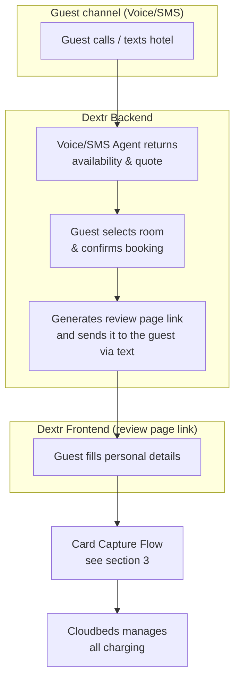
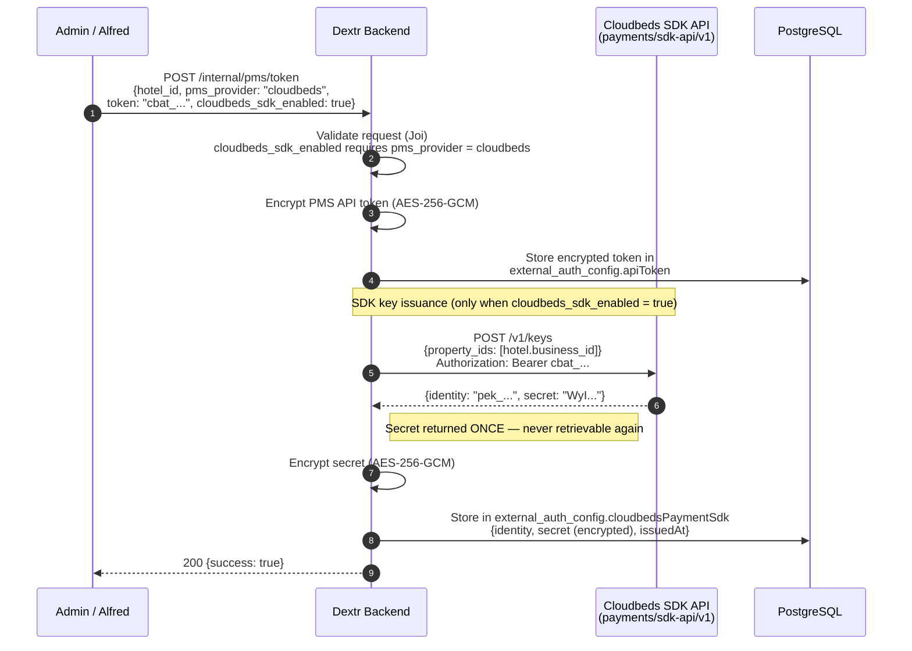
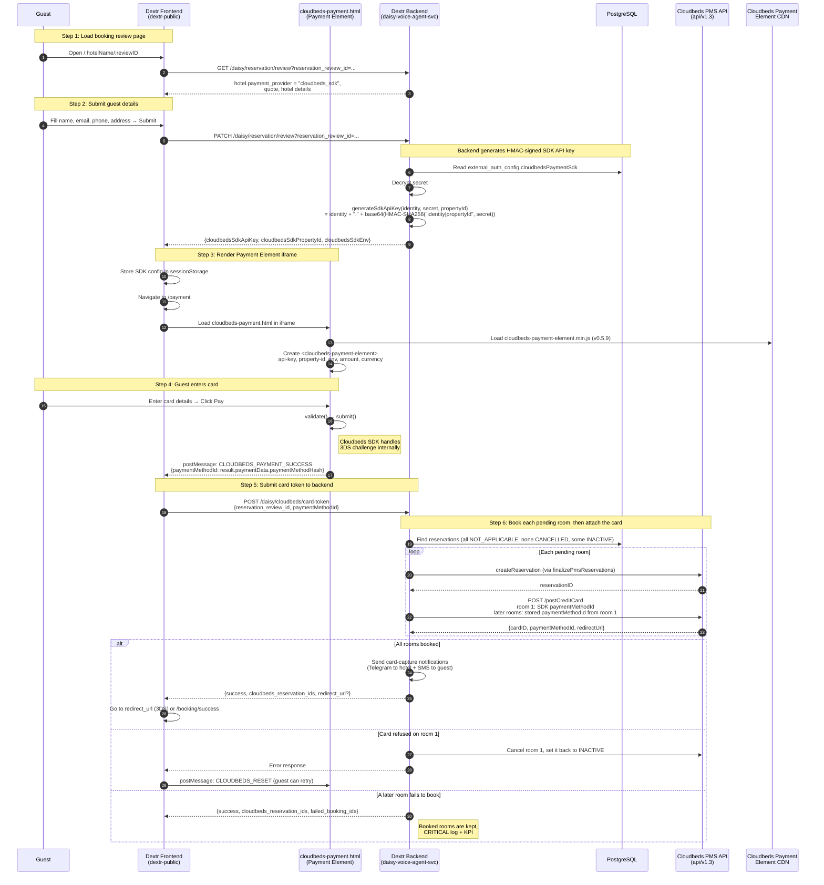

# Dextr × Cloudbeds SDK Payment Integration Flow

This document describes how Dextr's Daisy Voice Agent platform integrates with
the **Cloudbeds Payment SDK** for secure card-on-file capture during booking.
Unlike Shift4/Mews where Dextr charges the card directly, the Cloudbeds SDK
flow only **attaches** the guest's card to the Cloudbeds reservation — all
actual charging (deposits, balances, incidentals) is managed by **Cloudbeds**
according to the hotel's payment gateway and policies.

Legend:
- **Dextr Voice Agent** – AI agent that speaks/texts with the guest.
- **Dextr Backend** – Node.js service (`daisy-voice-agent-svc`).
- **Dextr Frontend** – Guest-facing web form (`dextr-public`) that hosts the Cloudbeds Payment Element iframe.
- **Cloudbeds SDK** – Cloudbeds Payment Element web component (`cloudbeds-payment-element`). PCI-compliant card tokenization.
- **Cloudbeds PMS API** – Cloudbeds REST API (`api.cloudbeds.com/api/v1.3`). Used for reservation creation + card attachment.
- **Cloudbeds SDK API** – Payments SDK API (`api.cloudbeds.com/payments/sdk-api/v1`). Used for issuing SDK key pairs.

External references:
- [Cloudbeds Payment Processing Blueprint](https://developers.cloudbeds.com/docs/payment-processing)
- [Cloudbeds Payment Element npm](https://github.com/orgs/cloudbeds/packages/npm/package/payment-element-webcomponent)
- [postCreditCard API](https://developers.cloudbeds.com/reference/post_postcreditcard-2)

---

## 1. End-to-end overview



### Key difference from Shift4/Mews/Stripe

| Aspect | Shift4 / Mews / Stripe | Cloudbeds SDK |
|--------|----------------------|---------------|
| Who charges the card | Dextr Backend | Cloudbeds |
| Payment at booking | Deposit charged immediately | Card attached only (no charge), unless the hotel sets `payment_configuration.charge_at_booking` — then the Cloudbeds balance is charged with `postCharge` right after (section 3) |
| Auto-charge | Dextr scheduler runs every ~5 min | Managed by Cloudbeds per hotel policy |
| Refunds | Dextr dashboard → provider API | Manual in Cloudbeds dashboard |
| 3DS handling | Dextr manages 3DS challenge | Cloudbeds SDK handles 3DS internally |

---

## 2. Credential provisioning (one-time setup per hotel)

Before a hotel can accept Cloudbeds SDK payments, an admin must provision
SDK credentials via the internal API. This issues a Cloudbeds SDK key pair
and stores it encrypted in the database.

Code references:
- `websocket-server/src/controller/internal/internalPmsTokenController.ts` – `storeToken`
- `websocket-server/src/cloudbeds/services/CloudbedsSdkPaymentProviderService.ts` – `issueAndStoreSdkKey`
- `websocket-server/src/validators/internalPmsTokenSchema.ts` – Joi validation schema



### What gets stored in the database

| Column | Field | Value | Encrypted? |
|--------|-------|-------|------------|
| `external_auth_config` | `apiToken` | Cloudbeds PMS bearer token (`cbat_*`) | Yes (AES-256-GCM) |
| `external_auth_config` | `cloudbedsPaymentSdk.identity` | SDK public key (`pek_*`) | No |
| `external_auth_config` | `cloudbedsPaymentSdk.secret` | SDK private key | Yes (AES-256-GCM) |
| `external_auth_config` | `cloudbedsPaymentSdk.issuedAt` | ISO timestamp | No |
| `hotels` | `business_id` | Cloudbeds propertyID | No |
| `hotels` | `payment_provider` | `cloudbeds_sdk` | No |

---

## 3. Card capture flow (booking payment)

This is the main flow that runs when a guest books a room. The guest's card
is tokenized by the Cloudbeds Payment Element and attached to the Cloudbeds
reservation. **No charge is made** — Cloudbeds handles all charging —
unless the hotel opts in with `payment_configuration.charge_at_booking: true`.
Then, after the card is attached, each room is charged what the review page
showed as due now (the deposit policy's `amount_charged`; no policy = the full
total), capped by its Cloudbeds balance (`getReservation` → `balance`; a full
payment may settle Cloudbeds' total up to 5 cents above Daisy's quote). A room
with nothing due now keeps the card on file only. The charge uses `postCharge`
(`isDeposit: true`, hotel currency, `redirectUrl` for 3DS). If Cloudbeds
clearly refuses room 1's charge (`failed`/`canceled`, or a 4xx /
`success: false`, after trying the payment-form card id and then the stored
card id), every room booked in this request is
cancelled and made pending again so the guest can retry. An unknown outcome
(timeout, 5xx, no usable balance) is never retried or cancelled, because money
may have moved: the booking is kept, logged CRITICAL, and the Telegram note
asks the team to check the payment in Cloudbeds. The same note covers a later
room refused and rooms left uncharged behind a 3DS page. A charge that needs
3DS returns `redirect_url` to the page.

**Flow order (differs from Shift4/Mews):** PMS reservation is created
**before** card attachment because `postCreditCard` requires a
Cloudbeds `reservationID`.

Code references:
- `websocket-server/src/services/roomReservation/roomReservationService.ts` – `submitReviewAndProcessReservation` (PATCH handler, returns SDK config)
- `websocket-server/src/services/roomReservation/roomReservationService.ts` – `processCloudbedsPaymentAndCreateReservations` (POST handler, creates reservation + attaches card)
- `websocket-server/src/cloudbeds/services/CloudbedsSdkPaymentProviderService.ts` – `getSdkApiKey`, `processCardPayment`
- `websocket-server/src/cloudbeds/utils/generateSdkApiKey.ts` – HMAC-SHA256 key signing
- `websocket-server/src/cloudbeds/client/CloudbedsClient.ts` – `postCreditCard`
- `dextr-public/src/pages/Payment/providers/cloudbeds.ts` – frontend adapter
- `dextr-public/public/cloudbeds-payment.html` – Payment Element iframe



---

## 4. API key signing algorithm

The `api-key` attribute on the Payment Element is **not** the raw `identity` —
it is an HMAC-signed token generated server-side on each PATCH request.

```
message  = "{identity}|{propertyId}"
hmac     = HMAC-SHA256(message, secret)
api-key  = "{identity}.{base64(hmac)}"
```

Code: `websocket-server/src/cloudbeds/utils/generateSdkApiKey.ts`

```typescript
export function generateSdkApiKey(
  identity: string,
  secret: string,
  propertyId: string,
): string {
  const message = `${identity}|${propertyId}`;
  const hmac = crypto
    .createHmac('sha256', secret)
    .update(message)
    .digest('base64');
  return `${identity}.${hmac}`;
}
```

The `api-key` does not expire — it remains valid as long as the underlying
key pair has not been revoked. Per Cloudbeds recommendation, we regenerate
it server-side on each PATCH request.

---

## 5. Retry behavior

Only rooms still INACTIVE are booked. If the card is refused on the first
room, that room is cancelled in Cloudbeds and set back to INACTIVE, so a
retry books it again with the new card. If a later room fails, the rooms
already booked stay ACTIVE and a retry books only the failed ones.

A submission claims its pending rooms (`pms_booking_claimed_at`) before
calling Cloudbeds, so a second submission for the same booking (another tab,
a network retry) is refused with "already being confirmed" instead of
booking the rooms twice. A claim older than 5 minutes is treated as a crashed
request and can be taken over.

---

## 6. What Dextr does NOT handle for Cloudbeds SDK

Since Cloudbeds manages all charging, several flows are explicitly blocked
or no-op'd on the Dextr side:

| Feature | Behavior | Code location |
|---------|----------|---------------|
| **Auto-charge setup** | Returns `{success: true}` immediately (no-op). Cloudbeds handles this. | `roomReservationService.ts` → `setupAutoCharge` |
| **Direct charge** (manual) | Returns `{success: false}` with message. Hotel must charge in Cloudbeds dashboard. | `roomReservationService.ts` → `chargeReservationImmediately` |
| **Refunds** | Throws `BadRequestError`. Must be processed manually in Cloudbeds dashboard. | `CloudbedsSdkPaymentProviderService.refundCardPayment` |
| **Scheduled auto-charges** (cron) | Skipped — no executor registered in `AutoChargeExecutorFactory`. | `AutoChargeExecutorFactory.ts` |

---

## 7. Data & credential model summary

### Two credential systems per hotel

| Purpose | DB location | Used by | Encrypted? |
|---------|-------------|---------|------------|
| **PMS API token** (`cbat_*`) | `external_auth_config.apiToken` | `CloudbedsClient` (postCreditCard, createReservation, all PMS calls) | Yes |
| **SDK key pair** (identity + secret) | `external_auth_config.cloudbedsPaymentSdk` | `generateSdkApiKey` → frontend Payment Element `api-key` attribute | Secret: Yes, Identity: No |

### Property ID resolution

The Cloudbeds `propertyID` is **not** stored with the SDK credentials.
It is resolved at runtime from `hotels.business_id`.

### Payment status

Cloudbeds SDK reservations are created with `payment_status = NOT_APPLICABLE`
and no `payments` row, the same as no-payment hotels
(`takesNoDextrPayment` in `types/enums.ts`). That keeps them out of payment
reminders, charges, auto-charge, payment summaries and refunds. Unsubmitted
bookings are cancelled by the existing no-payment stale sweep. The card lives
only in Cloudbeds; Dextr stores nothing about it.

---

## 8. Environment variables

| Variable | Purpose | Default | Example |
|----------|---------|---------|---------|
| `CLOUDBEDS_SDK_API_BASE_URL` | Payments SDK API for key issuance | (none — required) | `https://api.cloudbeds.com/payments/sdk-api` |
| `CLOUDBEDS_SDK_ENV` | Environment passed to Payment Element | `stage` | `prod`, `stage`, `dev`, `local` |
| `CLOUDBEDS_BASE_URL` | PMS API base URL | (none) | `https://api.cloudbeds.com/api/v1.3` |
| `ENCRYPTION_SECRET` | AES-256-GCM key for encrypting tokens/secrets at rest | (none — required) | 32-byte hex string |

Frontend (dextr-public) has **no** Cloudbeds-specific env variables.
All SDK config comes dynamically from the backend PATCH response.

---

## 9. API routes

| Method | Route | Auth | Handler | Purpose |
|--------|-------|------|---------|---------|
| `POST` | `/internal/pms/token` | `x-api-key` | `internalPmsTokenController.storeToken` | Store PMS token + issue SDK key pair |
| `GET` | `/daisy/reservation/review` | — | `submitReviewAndProcessReservation` | Returns `hotel.payment_provider: "cloudbeds_sdk"` |
| `PATCH` | `/daisy/reservation/review` | — | `submitReviewAndProcessReservation` | Returns `cloudbedsSdkApiKey`, `cloudbedsSdkPropertyId`, `cloudbedsSdkEnv` |
| `POST` | `/daisy/cloudbeds/card-token` | — | `submitCloudbedsCardTokenAndCreateReservations` | Book each room + attach card |

### Request/response shapes

**POST /daisy/cloudbeds/card-token**

Request:
```json
{
  "reservation_review_id": "abc-123",
  "paymentMethodId": "cbpm_..."
}
```

Success response (`failed_booking_ids` only when a later room failed,
`redirect_url` only when Cloudbeds asks for 3DS):
```json
{
  "success": true,
  "cloudbeds_reservation_ids": ["12345678"],
  "failed_booking_ids": ["BK123_2"],
  "redirect_url": "https://..."
}
```

**PATCH /daisy/reservation/review** (Cloudbeds SDK fields in response)

```json
{
  "cloudbedsSdkApiKey": "pek_abc123.Base64HmacSignature==",
  "cloudbedsSdkPropertyId": "320454",
  "cloudbedsSdkEnv": "prod"
}
```

---

## 10. File map

### Backend (`daisy-voice-agent-svc/websocket-server/src/`)

| File | Responsibility |
|------|---------------|
| `cloudbeds/services/CloudbedsSdkPaymentProviderService.ts` | Core service: key issuance, credential resolution, card payment, refund block |
| `cloudbeds/utils/generateSdkApiKey.ts` | HMAC-SHA256 api-key signing |
| `cloudbeds/client/CloudbedsClient.ts` | HTTP client: `postCreditCard`, `createReservation`, all PMS calls |
| `cloudbeds/types/PaymentSdkConfig.ts` | `CloudbedsPaymentSdkConfig` interface |
| `controller/internal/internalPmsTokenController.ts` | `POST /internal/pms/token` handler |
| `controller/roomReservationController.ts` | `submitCloudbedsCardTokenAndCreateReservations` |
| `validators/internalPmsTokenSchema.ts` | Joi schema for token endpoint |
| `validators/cloudbedsCardTokenSchema.ts` | Joi schema for card-token endpoint |
| `services/roomReservation/roomReservationService.ts` | Orchestrates: review submit → SDK config return, card-token → reservation + card attach |
| `services/payment/PaymentProviderFactory.ts` | Registers `CLOUDBEDS_SDK` provider |
| `repositories/HotelConfigurationRepository.ts` | `updateExternalAuthConfigCloudbedsPaymentSdkByHotelId` |
| `types/hotelConfiguration.ts` | `ExternalAuthConfig.cloudbedsPaymentSdk` field |
| `types/enums.ts` | `PaymentProvider.CLOUDBEDS_SDK = 'cloudbeds_sdk'` |
| `config.ts` | `CLOUDBEDS_SDK_API_BASE_URL`, `CLOUDBEDS_SDK_ENV` |

### Frontend (`dextr-public/src/`)

| File | Responsibility |
|------|---------------|
| `pages/Payment/providers/cloudbeds.ts` | Payment adapter: session config, submit, parse |
| `pages/Payment/providers/types.ts` | `PaymentNavState` with Cloudbeds SDK fields |
| `pages/Payment/usePaymentGateway.ts` | Provider-agnostic iframe + submit hook |
| `public/cloudbeds-payment.html` | Cloudbeds Payment Element iframe host |
| `services/bookingApi.ts` | `postCloudbedsCardToken`, `buildPaymentConfig`, API types |
| `utils/postSubmitHandlers.ts` | PATCH response → `/payment` navigation with SDK config |
| `constants/pmsProvider.ts` | `PaymentProvider.CLOUDBEDS_SDK` constant |
| `types/HotelDetails.ts` | `PaymentConfig` union with `cloudbeds_sdk` variant |
