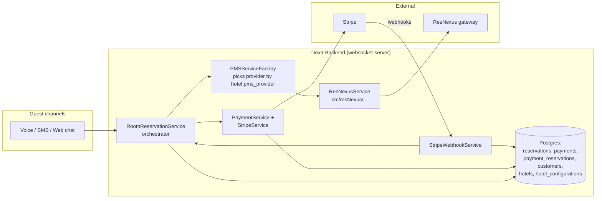
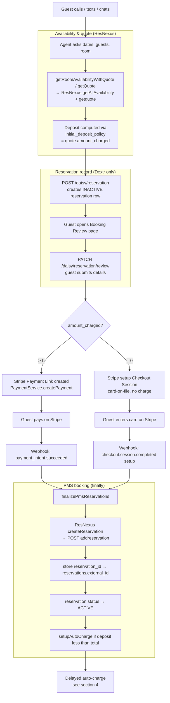
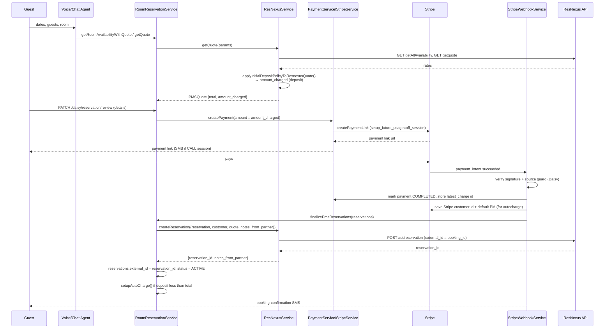
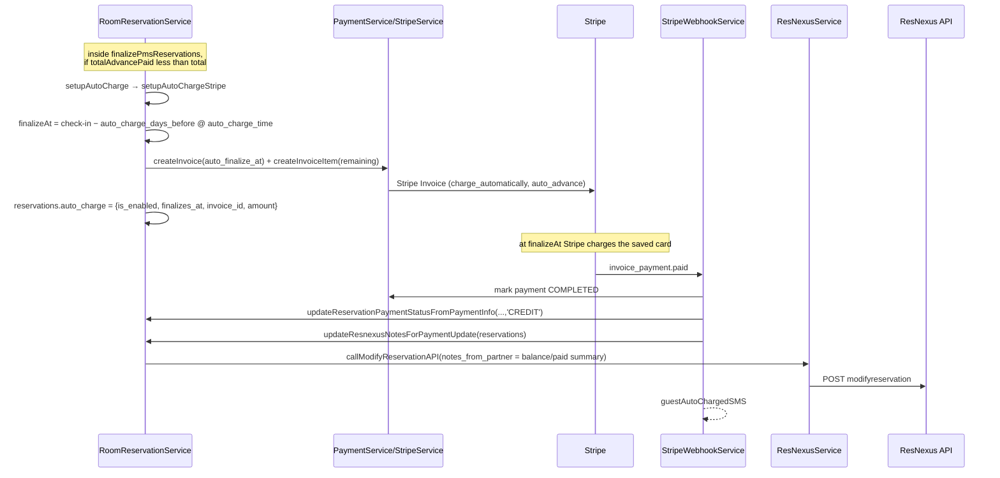
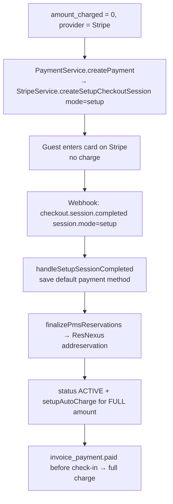
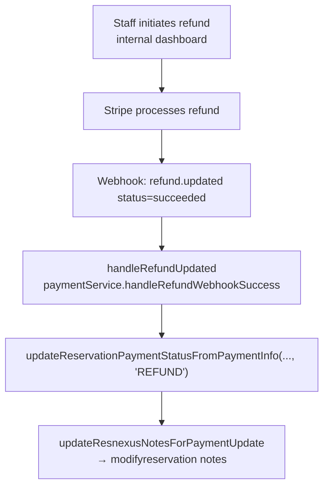
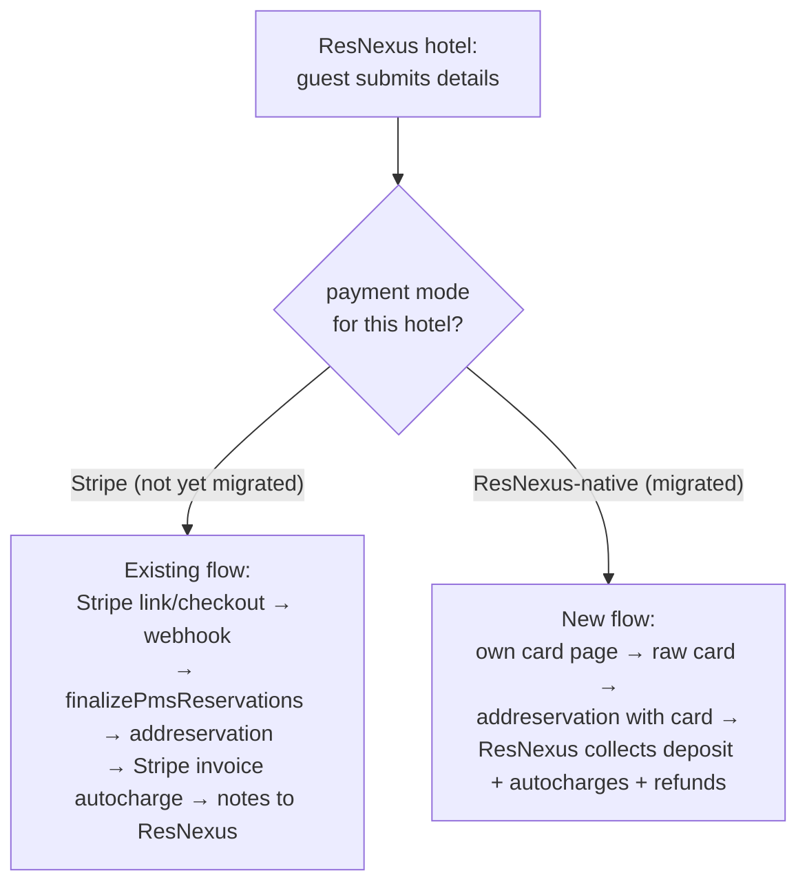

# Dextr × ResNexus Reservation Flow (Current, Stripe-based)

This document describes how Dextr's Daisy Voice Agent platform integrates with
**ResNexus** today, and how **Stripe** sits in front of ResNexus for deposit
collection and remaining-balance auto-charge.

> **Why this doc exists:** We are moving ResNexus off Stripe. In the new design
> we host our own card-collection page, collect raw card details, and pass them
> directly to ResNexus's
> [`add-reservation`](https://info.availabilityexchange.com/add-reservation) API.
> ResNexus then handles **everything money-related** — deposit collection,
> auto-charge of the remaining amount, and refunds. Dextr collects no payment
> and processes no refund in the new flow.
>
> **Both architectures must co-exist.** We already have several properties live
> on ResNexus + Stripe. We migrate them to ResNexus-native payments **one
> property at a time**, so the Stripe path (this document, sections 2–6) and the
> new ResNexus-native path must run side by side, selected per hotel. See
> section 9 for the co-existence model and the "what changes" contrast.

Legend:
- **Guest channel** – Voice (Google Voice → Twilio → Vapi) / SMS / Web chat.
- **Dextr Backend** – Node.js/TypeScript service (`daisy-voice-agent-svc`, `websocket-server/`).
- **Booking Review Page** – Guest-facing web form where the guest enters details.
- **Stripe** – Payment link/checkout + webhooks + invoices (auto-charge).
- **ResNexus** – PMS. REST gateway at `https://www.availabilityexchange.com/gateway`.

**Key architectural fact:** ResNexus itself has **no payment API** in this
integration. All money movement happens on the Dextr side via Stripe. ResNexus
is created *after* Stripe confirms payment, and is kept informed of amounts
paid/owed only through the free-text `notes_from_partner` field on the
reservation. This is exactly the coupling the new (Stripe-free) flow removes.

---

## 1. Component map

The whole app is PMS-agnostic: everything upstream talks to the
`IPMSReservationService` interface
(`websocket-server/src/pms/types/IPMSReservationService.ts`).
`PMSServiceFactory.getReservationService(hotelId)`
(`websocket-server/src/pms/PMSServiceFactory.ts:30`) reads `hotel.pms_provider`
and returns the `resNexusService` singleton for `PmsProvider.RESNEXUS`.

---

## 2. End-to-end overview (deposit flow)

The defining property: **the PMS booking is not created until Stripe confirms
payment.** Between quote and payment, the reservation lives in Dextr's DB as an
inactive record with no ResNexus counterpart.

### Route surface (README API routes)

| Route | Purpose |
|-------|---------|
| `GET /daisy/availability-lite`, `GET /daisy/multi-availability-lite` | Single / multi-room availability + pricing (ResNexus `getAllAvailability`) |
| `POST /daisy/reservation` | Create INACTIVE reservation + booking review link |
| `GET /daisy/reservation/review` | Load booking review page |
| `PATCH /daisy/reservation/review` | Submit details → return Stripe link (or create booking directly if `NOT_APPLICABLE`) |
| `POST /webhook/stripe/payment-complete` | Platform-account Stripe webhook |
| `POST /webhook/stripe/connected-payment` | Connected-account Stripe webhook |

---

## 3. Deposit collection — detailed sequence

**Deposit computation** — `applyInitialDepositPolicyToResnexusQuote`
(`websocket-server/src/resNexus/utils/helper.ts:316`), driven by the hotel's
`initial_deposit_policy`:
- `PaymentProvider.NOT_APPLICABLE` → `amount_charged = 0` (no payment collected; booking created immediately, no Stripe).
- Otherwise match a tier by night count, then apply `FIRST_NIGHT_PLUS_TAX`, `PERCENTAGE` (100 = full upfront, 0 = card-only capture), or `FLAT`. Capped at `total_amount`.

**PMS create step** — `finalizePmsReservations`
(`websocket-server/src/services/roomReservation/roomReservationService.ts:5338`):
resolves the provider via the factory, calls `pmsService.createReservation(...)`
(ResNexus at `reservationService.ts:129` → POST `addreservation`), stores
`reservation_id` into `reservations.external_id`, flips status to `ACTIVE`
(`:5591`), logs `KpiStat.PmsBookingCreated`, and calls `setupAutoCharge`
(`:5611`). If the ResNexus create fails *after* money was taken,
`escalationService.handleEscalation` alerts the team (money collected, booking
failed → manual resolution). The `/jobs/reservations/paid-not-created` scheduled
job is the safety net that catches these.

---

## 4. Remaining-balance auto-charge (deposit now, charge rest later)

Stripe auto-charge is **invoice-driven** — Stripe itself finalizes and charges
at the scheduled time; there is no Dextr polling job for the Stripe path.

Key pieces:
- `setupAutoChargeStripe` — `roomReservationService.ts:11322`. Computes
  `finalizeAt` from `hotel_configurations.payment_configuration`
  (`auto_charge_days_before` + `auto_charge_time`, hotel timezone), creates a
  PENDING payment + Stripe Invoice, persists `auto_charge` JSON on each
  reservation (column added in migration `070`).
- Stripe fires `invoice_payment.paid` → `handleInvoicePaymentSucceeded`
  (`stripeWebhookService.ts:750`). `computeChargeAmount` returns
  `total − depositAlreadyCharged`.
- **ResNexus is only told about money via notes.**
  `updateResnexusNotesForPaymentUpdate` (`roomReservationService.ts:12157`, runs
  only when `pms_provider === RESNEXUS`) recomputes paid/refunded totals,
  formats them with `generateResNexusPartnerNotes`
  (`src/resNexus/utils/helper.ts:281`), and pushes them back via
  `callModifyReservationAPI` (POST `modifyreservation`). There is no ResNexus
  "post payment" call — the notes field is the only channel.

---

## 5. Zero-deposit (card-on-file) flow

Triggered when `initial_deposit_policy` yields `amount_charged === 0` **and**
provider is Stripe.

`handleSetupSessionCompleted` — `stripeWebhookService.ts:1559`. No charge at
booking; the entire amount is collected later via the same invoice-driven
auto-charge (section 4).

---

## 6. Refund flow

Refunds are initiated manually (internal dashboard), processed by Stripe, and
confirmed via webhook.

`handleRefundUpdated` — `stripeWebhookService.ts:1079`. Refund amounts are again
reflected to ResNexus only through the partner-notes field.

---

## 7. ResNexus API surface & auth

`ResNexusService` (`websocket-server/src/resNexus/service/reservation/reservationService.ts:108`)
implements `IPMSReservationService`. Base URL
`https://www.availabilityexchange.com/gateway`.

| Operation | Method → endpoint | Where |
|-----------|-------------------|-------|
| Create reservation | `createReservation` → POST `addreservation` | `reservationService.ts:129` / util `:213` |
| Cancel | `cancelReservation` → POST `cancelreservation` | `:247` |
| Modify (incl. notes update) | `callModifyReservationAPI` → POST `modifyreservation` | `:282` |
| Quote | `getQuote` → GET `getquote` | `:495` / util `:371` |
| Availability | `getAvailability` → GET `getAllAvailability` | `:659` |
| Calendar | `getCalendar` → GET `getcalendar` | `:710` |
| Unit groups (room types) | `getUnitGroups` → GET `getunitgroups` | `:828` |

- **Auth:** HTTP Basic — `Basic base64(username:password)` built in
  `resNexusAuth.ts:3` from `RESNEXUS_USERNAME` / `RESNEXUS_PASSWORD`; injected on
  every request by the Axios interceptor in `resNexusInterceptor.ts`.
- **Room id mapping:** the PMS-agnostic `room_id` maps to ResNexus's
  `unit_group_id`.
- **External id:** `external_id` on the `addreservation` request =
  `reservation.booking_id.toUpperCase()`; the returned `reservation_id` is
  stored on `reservations.external_id`.
- **Errors:** `ResNexusError` (`src/errors/extenal/ResNexusError.ts`) maps
  ResNexus `response_errors` to user-facing messages (400). Every API method
  checks `data.response_errors?.length`.

### Config / ENV (`websocket-server/src/config.ts:187`)
`RESNEXUS_BASE_URL`, `RESNEXUS_USERNAME`, `RESNEXUS_PASSWORD`,
`RESNEXUS_TEST_MODE` (`EVALUATE_1/2`, `ATTEST_1/2` — certification harness),
`RESNEXUS_TEST_BUSINESS_ID`, and the canned `RESNEXUS_*_EVALUATE_*/ATTEST_*_RESPONSE`
JSON blobs used during certification.

---

## 8. Data model touchpoints

| Table | Columns that matter here |
|-------|--------------------------|
| `reservations` | `external_id` (ResNexus reservation id; was `resnexus_id`, renamed in migration `052`), `external_public_id`, `payment_status`, `auto_charge` jsonb (`{is_enabled, finalizes_at, invoice_id, amount}`, migration `070`), `status` (INACTIVE→ACTIVE), `notes_from_partner` |
| `payments` | `booking_confirmation_id` (Stripe latest-charge id), `payment_link`, `payment_link_id` (Stripe PaymentLink/Checkout Session, or Invoice id for autocharge), `amount_charged`, `amount_refunded`, `payment_status`, `payment_provider` |
| `payment_reservations` | junction: `payment_id` ↔ `reservation_id` (one payment can cover multiple reservations) |
| `customers` | `payment_provider_customer_id` (Stripe customer id — required for off-session autocharge) |
| `hotels` | `pms_provider` (= `resnexus`), `payment_provider` (STRIPE / SHIFT4 / MEWS / NOT_APPLICABLE) |
| `hotel_configurations` | `payment_account_id` (Stripe connected-account id), `payment_configuration` jsonb (`auto_charge_days_before`, `auto_charge_time`), `initial_deposit_policy` |

---

## 9. Co-existence & what changes (for the new implementation)

### 9.1 Two payment paths, one property at a time

Both architectures ship together and are selected **per hotel**. Migration is
gradual — each ResNexus property is flipped from Stripe to ResNexus-native
payments individually, so at any given time some ResNexus hotels use Stripe
(sections 2–6) and others use the new native flow.

**Implementation note for the new person:** the two paths need a per-hotel
selector so both can run in the same deployment. The natural place is the same
mechanism that already routes payments today — `hotel.payment_provider` (a new
value, e.g. `RESNEXUS`/native, distinct from `STRIPE`) resolved through
`PaymentProviderFactory` / the branch in the reservation-review submit path.
Do **not** fork `ResNexusService` — the availability/quote/create surface is
shared; only the payment leg differs. Keep all Stripe code intact for
un-migrated hotels; gate the new card-collection + `add-reservation`-with-card
path behind the per-hotel flag.

### 9.2 What changes

This is the contrast the new flow targets. Nothing about availability/quote
changes — only the payment leg. In the new flow Dextr collects **no** payment
and processes **no** refund; the Stripe payment-collection and refund events
become obsolete for migrated properties.

| Concern | Today (Stripe) | New (raw card → ResNexus `add-reservation`) |
|---------|----------------|----------------------------------------------|
| Scope | Applies to hotels **not yet migrated** | Applies to **migrated** hotels |
| Card capture | Stripe-hosted payment link / checkout | **Our own card-collection page** captures raw PAN/exp/CVV |
| When PMS booking is created | *After* Stripe webhook confirms payment (`finalizePmsReservations`) | At card submission — card passed straight to ResNexus `add-reservation` |
| Deposit collection | Dextr computes deposit, charges via Stripe payment link | **ResNexus** collects the deposit automatically (Dextr collects nothing) |
| Remaining balance | Dextr Stripe Invoice + `invoice_payment.paid` webhook + `setupAutoCharge` | **ResNexus** auto-charges the remaining amount |
| Refunds | Staff → Stripe → `refund.updated` webhook | **ResNexus** handles refunds; Dextr does not process them |
| Money reflected to ResNexus | Only via `notes_from_partner` (modify calls) | Native — ResNexus owns the ledger |
| Webhooks | `payment_intent.succeeded`, `invoice_payment.paid`, `checkout.session.completed`, `refund.updated` | **None** — all Stripe payment & refund events become obsolete for this hotel |
| PCI scope | Stripe (NIL, since Resnexus didn't ask us for PCI compliance) | **Raises PCI scope** — we now handle raw card data. SAQ D compliance needed. It is currently being undertaken by Aslam and Scott |

Integration points the new flow bypasses **for migrated hotels only** (all of
these stay in place and keep running for un-migrated Stripe hotels):
- `PaymentService.createPayment` / `StripeService.createPaymentLink` /
  `createSetupCheckoutSession` — bypassed; our card page calls `add-reservation`
  with card details directly.
- `StripeWebhookService` handlers (`payment_intent.succeeded`,
  `checkout.session.completed`, `invoice_payment.paid`, `refund.updated`) — not
  the trigger for migrated hotels; the booking is created synchronously with the
  card submission instead. (The handlers still fire for Stripe hotels — do not
  remove them.)
- `setupAutoChargeStripe` + Stripe Invoice — not used for migrated hotels;
  ResNexus owns auto-charge.
- `updateResnexusNotesForPaymentUpdate` — obsolete for migrated hotels once
  ResNexus owns the payment ledger; still needed for Stripe hotels to carry
  balance-due/paid summaries.

> **PCI caveat worth raising with the team before building:** collecting raw
> card details on our own page moves us out of Stripe's SAQ A scope. Confirm the
> compliance posture (and what ResNexus's `add-reservation` expects for card
> fields / tokenization) before implementation.

---

## 10. Key files quick-reference

| File | Role |
|------|------|
| `websocket-server/src/resNexus/service/reservation/reservationService.ts` | ResNexus API client + all operations |
| `websocket-server/src/resNexus/utils/{resNexusAuth,resNexusInterceptor,helper}.ts` | Auth, Axios client, quote/deposit/notes transforms |
| `websocket-server/src/pms/PMSServiceFactory.ts` | Selects ResNexus by `hotel.pms_provider` |
| `websocket-server/src/pms/types/IPMSReservationService.ts` | PMS-agnostic interface |
| `websocket-server/src/services/roomReservation/roomReservationService.ts` | Orchestrator: quote → reservation → `finalizePmsReservations` → autocharge; `updateResnexusNotesForPaymentUpdate` |
| `websocket-server/src/services/payment/paymentService.ts` | `createPayment`, payment records, autocharge setup |
| `websocket-server/src/services/stripe/stripeService.ts` | Stripe payment links, setup sessions, invoices |
| `websocket-server/src/services/stripe/webhook/stripeWebhookService.ts` | All Stripe webhook handlers |
| `websocket-server/src/controller/webhooks/stripeWebhookController.ts` | Webhook routes |
| `websocket-server/src/config.ts` | `RESNEXUS_*` and `STRIPE_*` config |
