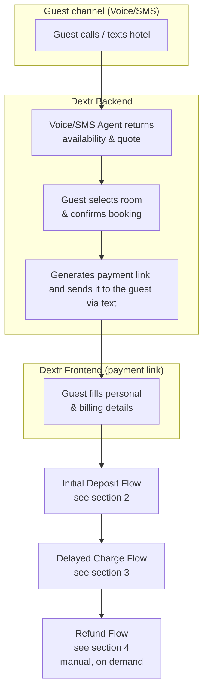
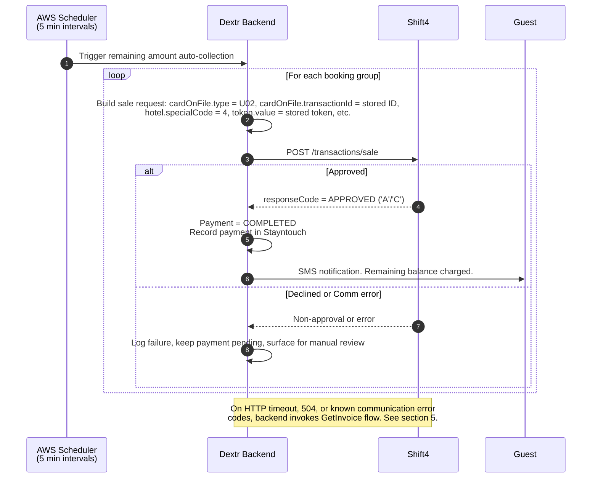
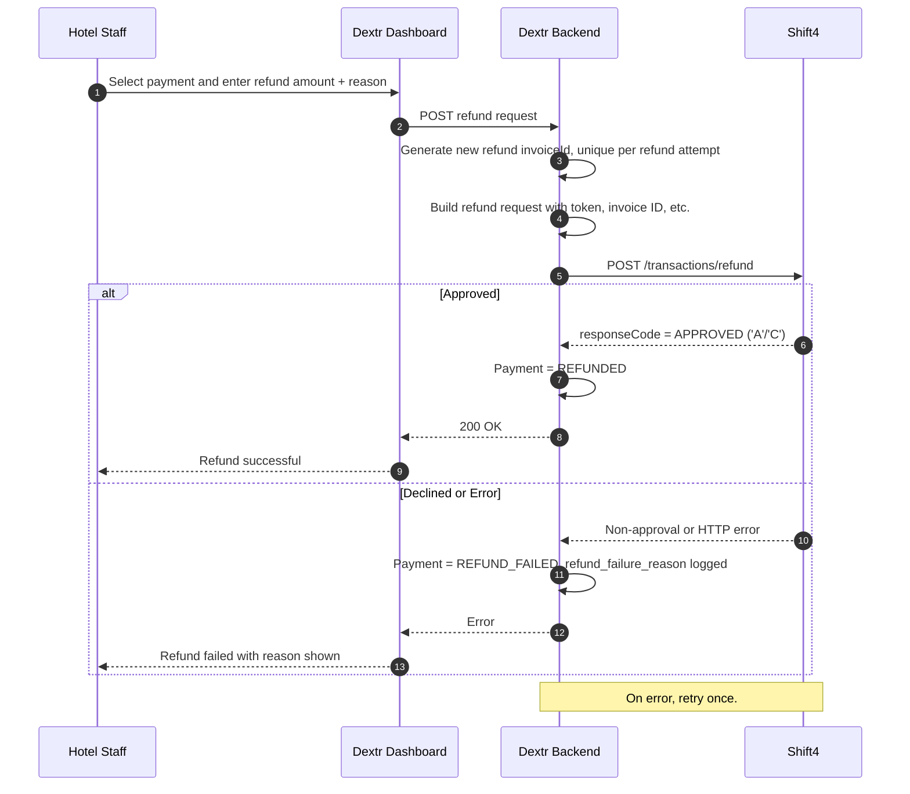
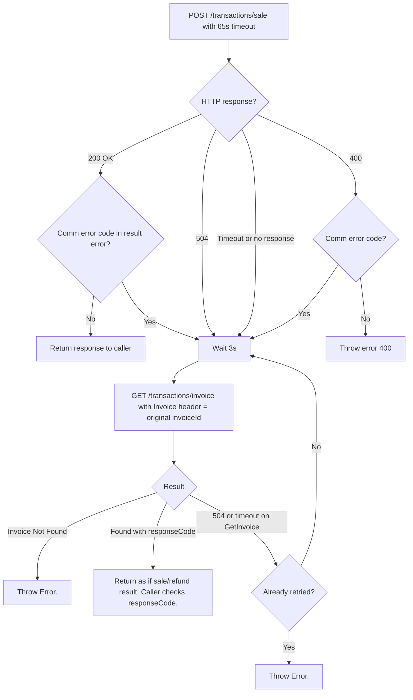

# Dextr × Shift4 Payment Integration Flow

This document describes how Dextr's Daisy Voice Agent platform integrates with
Shift4 for (1) initial deposit collection at the time of booking, (2) delayed
auto-charges for the remaining balance, and (3) refunds initiated from the
Dextr internal dashboard.

Legend:
- **Dextr Voice Agent** – AI agent that speaks/texts with the guest.
- **Dextr Backend** – Node.js / NestJS service (`daisy-voice-agent-svc`).
- **Dextr Frontend** – Guest-facing web form that hosts the Shift4 i4Go iframe.
- **Dextr Dashboard** – Internal web app used by hotel staff.
- **Shift4** – Shift4 Payments Platform (i4Go + REST Transactions API).

---

## 1. End-to-end overview



---

## 2. Initial deposit scenario

Triggered when the guest submits personal/billing details on the Dextr
secure page. The backend pre-authorizes with Shift4, the frontend renders
the i4Go iframe, and on card submission the backend finalizes with a
Sale/Purchase call.

Code references:
- `@/Users/Hashrin/Projects/Dextr/daisy-voice-agent-svc/websocket-server/src/services/roomReservation/roomReservationService.ts:3110-3184` – `handleShift4PreAuthorization`
- `@/Users/Hashrin/Projects/Dextr/daisy-voice-agent-svc/websocket-server/src/services/roomReservation/roomReservationService.ts:3193-3338` – `processShift4InitialDepositAndCreateReservations`
- `@/Users/Hashrin/Projects/Dextr/daisy-voice-agent-svc/websocket-server/src/services/shift4/shift4Service.ts:83-162` – `preauthorizeClient`
- `@/Users/Hashrin/Projects/Dextr/daisy-voice-agent-svc/websocket-server/src/services/shift4/shift4Service.ts:164-177` – `saleTransaction`
- `@/Users/Hashrin/Projects/Dextr/daisy-voice-agent-svc/websocket-server/src/services/shift4/shift4Service.ts:425-477` – `generateAccessToken`

```mermaid
sequenceDiagram
    sequenceDiagram
    autonumber
    participant Guest
    participant FE as Dextr Frontend
    participant BE as Dextr Backend
    participant S4 as Shift4

    Note over BE,S4: Access token is obtained per hotel and cached.

    Guest->>FE: Open Dextr payment page
    FE->>BE: Submit personal + billing details
    BE->>BE: Validate customer data
    BE->>BE: Load hotel accessToken

    Note right of BE: Pre-authorization 3DS + Card Verify
    BE->>S4: POST i4Go preauthorizeClient<br>steps = [3DS_STANDALONE, CARD_VERIFY] cardOnFile.type = S01
    S4-->>BE: i4go_accessblock, i4go_i4m_url, i4go_responsecode

    BE-->>FE: Pre-auth response: accessblock, i4m_url, response_code
    FE->>FE: Render Shift4 i4Go iframe using accessblock
    Guest->>FE: Enter card in iframe and submit
    FE-->>BE: iframe response

    Note right of BE: Finalize initial deposit
    BE->>BE: Build sale request: cardOnFile.type = S01, token = i4go_uniqueid, hotel special code = 3, etc.
    BE->>S4: POST /transactions/sale
    alt Approved
        S4-->>BE: responseCode = 'A'/'C'
        BE->>BE: Payment = COMPLETED, Reservation = CONFIRMED<br>Record payment in Stayntouch
        BE-->>FE: Success
    else Declined or Error
        S4-->>BE: Non-approval responseCode or comm-error code
        BE->>BE: payment FAILED, cleanup
        BE-->>FE: Failure
    end

    Note over BE,S4: On HTTP timeout, 504, or known communication error <br>codes, backend invokes GetInvoice flow. See section 5.
```

---

## 3. Delayed charge scenario (auto-collect remaining balance)

After the initial deposit, the remaining amount is auto-charged per the
hotel's collection schedule using the stored card-on-file credentials
(`transaction_id`, tokenized PAN, expiration). Scheduler runs every
~5 minutes.

Code references:
- `@/Users/Hashrin/Projects/Dextr/daisy-voice-agent-svc/websocket-server/src/services/roomReservation/roomReservationService.ts:3800-3963` – `processShift4DelayedCharge`
- `@/Users/Hashrin/Projects/Dextr/daisy-voice-agent-svc/websocket-server/src/services/roomReservation/roomReservationService.ts:3971-4163` – `processShift4AutoCharges`



---

## 4. Refund scenario (manual, via Dextr dashboard)

Hotel staff initiate partial or full refunds from Dextr's internal
dashboard. The backend calls Shift4's Refund transaction API using the
stored card token and the original invoice ID.

Code reference:
- `@/Users/Hashrin/Projects/Dextr/daisy-voice-agent-svc/websocket-server/src/services/payment/paymentService.ts:1240-1455` – `initiateShift4Refund`
- `@/Users/Hashrin/Projects/Dextr/daisy-voice-agent-svc/websocket-server/src/services/shift4/shift4Service.ts:179-192` – `refundTransaction`



---

## 5. Communication failure / GetInvoice flow (common to Sale & Refund)

Implements the flow from
<https://docs.shift4.com/guides/response-handling/timeouts-and-communications-failures>.

Code reference:
- `@/Users/Hashrin/Projects/Dextr/daisy-voice-agent-svc/websocket-server/src/services/shift4/shift4Service.ts:214-381` – `executeTransactionWithFailover` / `handleCommunicationFailure`



---

## 6. Data & credential model summary

Per-hotel Shift4 configuration lives in `config.HOTEL_SHIFT4_CONFIG[hotelId]`:
- `authToken` – used only to mint an `accessToken` via
  `POST /credentials/accesstoken`
  (`@/Users/Hashrin/Projects/Dextr/daisy-voice-agent-svc/websocket-server/src/services/shift4/shift4Service.ts:425-477`).
- `accessToken` – sent as the `AccessToken` header on every
  Transactions API call.

Global Shift4 configuration:
- `SHIFT4_BASE_URL`, `SHIFT4_ACCESS_URL` (i4Go URL used for pre-auth),
  `SHIFT4_CLIENT_GUID`,
  `SHIFT4_INTERFACE_NAME`, `SHIFT4_INTERFACE_VERSION`, `SHIFT4_COMPANY_NAME`,
  `SHIFT4_GLOBAL_TIMER_MS`, `SHIFT4_INVOICE_LOOKUP_DELAY_MS`.

Card-on-file data stored on the Dextr `customers` row after the first
successful sale (used for all delayed charges and refunds):
- `card_metadata.token` (Shift4 `i4go_uniqueid`, GTV token)
- `card_metadata.expiration_month` / `expiration_year`
- `card_metadata.transaction_id` (`cardOnFile.transactionId` from the
  approved sale response)
- `card_metadata.threeDSecure` (3DS result from the token submission)

Invoice IDs:
- One unique `invoiceId` is generated by Dextr per payment and is reused
  as both the Shift4 pre-auth `invoice` and the sale `transaction.invoice`.
- Refunds generate a separate `refundInvoiceId` per attempt; the original
  sale invoice is passed as `transaction.originalInvoice`.
