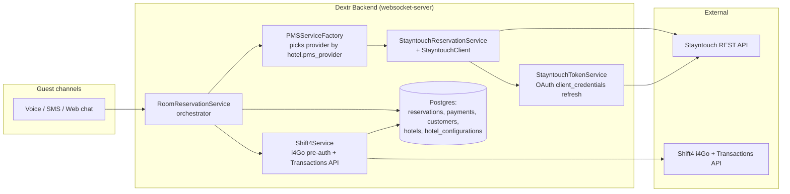
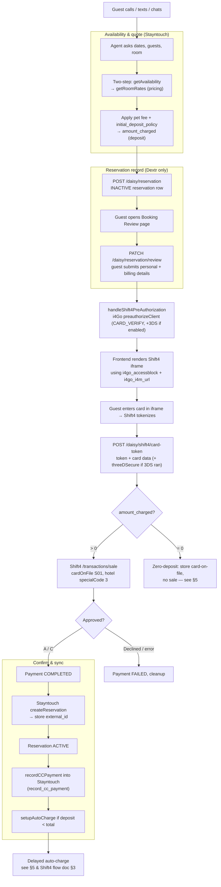

# Dextr × Stayntouch (PMS) + Shift4 (Payments) Integration

This document describes how Dextr's Daisy Voice Agent platform integrates with
**Stayntouch** as the PMS and **Shift4** as the payment processor. The two are
documented together because, unlike the ResNexus/Stripe or Cloudbeds/Stripe
stacks, **Stayntouch does not support Stripe** — every live Stayntouch property
today pays through Shift4, and the two integrations are operated as one unit.

> **Where each half is documented.** This doc owns the Stayntouch PMS surface
> (auth, availability, quote, reservation lifecycle, payment recording) and the
> *seam* between the two systems (booking review → Shift4 iframe → card-token →
> record payment back into Stayntouch). The Shift4 money-movement sequence
> diagrams (initial deposit, delayed charge, refund, communication-failure
> handling) live in [`../shift4/shift4-payment-flow.md`](../shift4/shift4-payment-flow.md)
> with rendered PNGs alongside it. Read both.

Legend:
- **Guest channel** – Voice (Twilio → Vapi) / SMS / Web chat.
- **Dextr Backend** – Node.js/TypeScript service (`daisy-voice-agent-svc`, `websocket-server/`).
- **Booking Review Page** – Guest-facing web form; also hosts the Shift4 i4Go iframe.
- **Stayntouch** – PMS of record. REST API, per-hotel Bearer token.
- **Shift4** – Payment platform (i4Go tokenization iframe + REST Transactions API). **No webhooks.**

---

## 0. Certification & provider status (read first)

- **Shift4** — we hold Shift4 **and** Stayntouch certifications. We certified
  against the **3DS-enabled** flow. In production we currently run with **3DS
  turned off** (see §6 for why and the pilot plan to re-enable it).
- **Payment providers Stayntouch supports:** Shift4, **Adyen**, **Planet**.
  Stripe is **not** supported. Every property we run today is on Shift4.
  - **If a new property uses Adyen or Planet instead of Shift4**, we must obtain
    that provider's certification (if any is required) before onboarding it —
    this integration does not cover Adyen/Planet, and no code exists for them
    yet. See [§9 TODOs](#9-open-items--todos).
- **Sandbox:** Stayntouch UAT dashboard at <https://app.uat.stayntouch.com>.
  The API/auth base URLs are entirely env-driven (`STAYNTOUCH_BASE_URL` /
  `STAYNTOUCH_AUTH_URL`) — point them at UAT for sandbox, prod for production.
- **Stayntouch reference docs:**
  - API spec — <https://api-specs.stayntouch.com/v2/index.html>
  - Integrations, APIs & IBE guide —
    <https://stayntouch.atlassian.net/wiki/spaces/WH/pages/3103883322/Integrations+APIs+and+Stayntouch+IBE+Guide>

---

## 1. Component map



The app is PMS-agnostic: everything upstream talks to the
`IPMSReservationService` interface
(`websocket-server/src/pms/types/IPMSReservationService.ts`).
`PMSServiceFactory.getReservationService(hotelId)` reads `hotel.pms_provider`
and returns a `StayntouchReservationService` (which builds a per-hotel
`StayntouchClient`) for `PmsProvider.STAYNTOUCH`. Payments route separately
through `Shift4Service` because `hotel.payment_provider === SHIFT4`.

**Key architectural fact:** Stayntouch and Shift4 are **two independent
credential domains** (§2). Stayntouch owns the reservation; Shift4 owns the
money. After a Shift4 sale approves, Dextr **records** the payment back into
Stayntouch via `record_cc_payment` (§4.6) so the PMS ledger stays in sync —
there is no automatic link between the two systems.

---

## 2. Credentials & auth model — two separate token systems

### 2.1 Stayntouch token (per-hotel, stored in our DB)

Stayntouch authenticates with a **Bearer token, scoped per hotel**, stored
encrypted in Postgres — **not** in an env var.

- **Where stored:** `hotel_configurations.external_auth_config` jsonb, key
  `apiToken` (AES-encrypted via `utils/encryption`). Same column Cloudbeds and
  Mews use; which provider applies is known from `hotels.pms_provider`, so the
  column is not keyed by provider name.
  (`websocket-server/src/types/hotelConfiguration.ts:380`)
- **How it's read:** `PmsTokenService.getActiveToken(hotelId)` decrypts and
  returns `apiToken`; the `StayntouchClient` request interceptor sets
  `Authorization: Bearer <token>` on every call.
  (`PmsTokenService.ts:89`, `StayntouchClient.ts:95`)
- **Per-hotel vs per-chain:** the *storage* is per-hotel (one row per hotel),
  but the *token value* can be shared across a chain. Stayntouch issues one
  token per hotel chain — e.g. all **Giri** hotels share the same token. When
  onboarding a hotel that belongs to a chain we already integrate, reuse the
  chain's existing token; store the same value on the new hotel's row.
- **How it's obtained & installed — two one-time calls, then auto-refresh.**
  Onboarding a Stayntouch hotel uses **both** internal APIs, in this order:
  1. **`POST /internal/pms/client-credentials`**
     (`{ hotel_id, pms_provider: "stayntouch", client_id, client_secret }`) —
     encrypts and stores the OAuth **`client_id` / `client_secret`** into
     `external_auth_config.oauth_client_id` / `oauth_client_secret`. These are
     **constants for a hotel chain** (the same for every hotel in the chain, and
     **different for a different chain**). (`internalPmsTokenController.ts:108`)
  2. **`POST /internal/pms/token`**
     (`{ hotel_id, pms_provider: "stayntouch", token }`) — encrypts and stores
     the **initial Bearer token** into `external_auth_config.apiToken`, **the
     first time only**. (`internalPmsTokenController.ts:29`)

  After those two, the automated refresh job (below) periodically re-mints the
  Bearer token from the stored client credentials — you never install a token
  by hand again.

**Token expiry & automated refresh (30-day cycle).** A Stayntouch Bearer token
**expires every 30 days**, so it must be re-minted on a schedule. The mechanism:

1. An **AWS cron job (EventBridge Scheduler)** fires on a ~25-day cadence (i.e.
   before the 30-day expiry) and invokes a **Lambda**.
2. The Lambda calls our endpoint
   **`POST /jobs/stayntouch/token/refresh`**
   (`scheduledJobsRouter.ts:30` → `scheduledJobsController.refreshStayntouchToken`,
   authenticated with `x-api-key` / `DAISY_INBOUND_API_KEYS`).
3. That invokes `StayntouchTokenService.refreshToken()`
   (`stayntouch/services/tokenService.ts:35`), which discovers every Stayntouch
   hotel that has stored OAuth client credentials, decrypts each hotel's
   `oauth_client_id` / `oauth_client_secret`, exchanges them at
   `STAYNTOUCH_AUTH_URL + /oauth/token` (`grant_type=client_credentials`), and
   writes the fresh Bearer token back into `external_auth_config.apiToken`.
4. The `StayntouchClient` interceptor then picks up the new `apiToken`
   automatically on the next request. Per-hotel failures are isolated — the job
   only errors if the refresh fails for *all* hotels.

> A one-time migration (`150_migrate_stayntouch_oauth_credentials_to_db.ts`)
> backfilled OAuth client credentials from the legacy `HOTEL_STAYNTOUCH_CONFIG`
> env var into the DB. New hotels use `/internal/pms/client-credentials`; do not
> add them back to env.

### 2.2 Shift4 credentials (per-hotel, stored in env)

Shift4 uses a **two-token exchange**, configured per hotel in the
`HOTEL_SHIFT4_CONFIG` env var (a JSON map keyed by hotel id):

```jsonc
// HOTEL_SHIFT4_CONFIG
{
  "<hotel-uuid>": { "authToken": "…", "accessToken": "…" }
}
```
(`config.ts:123`, shape `HotelShift4Config` at `types/shift4.ts:186`)

- **`authToken`** — long-lived, issued by Shift4 for the merchant. Used only to
  mint an `accessToken`.
- **`accessToken`** — sent as the credential on Transactions API calls and i4Go
  pre-auth. Minted from `authToken` + the global `SHIFT4_CLIENT_GUID` via
  `POST {SHIFT4_BASE_URL}/credentials/accesstoken`.
  (`shift4Service.generateAccessToken`, `shift4Service.ts:592`)

Our `/access-token` endpoint (§7.1) wraps `generateAccessToken` so ops can mint
an access token for a hotel and paste it into `HOTEL_SHIFT4_CONFIG`.

> **Shift4 has no webhooks** (unlike Stripe). Every outcome is learned
> synchronously from the API response; on timeout/comm-failure the backend
> reconciles with the GetInvoice flow (see the Shift4 flow doc, §5).

### 2.3 Global Shift4 config (`config.ts:258`)

`SHIFT4_ACCESS_URL` (i4Go pre-auth endpoint), `SHIFT4_BASE_URL` (REST base),
`SHIFT4_CLIENT_GUID`, `SHIFT4_INTERFACE_NAME` (`Dextr`),
`SHIFT4_INTERFACE_VERSION` (`4.0`), `SHIFT4_COMPANY_NAME` (`Dextr`),
`SHIFT4_GLOBAL_TIMER_MS` (65000), `SHIFT4_INVOICE_LOOKUP_DELAY_MS` (3000).

---

## 3. Stayntouch API surface

`StayntouchReservationService` (`stayntouch/services/reservationService.ts:135`)
implements `IPMSReservationService`; it builds a per-hotel `StayntouchClient`
(`stayntouch/client/StayntouchClient.ts`). Base URL `STAYNTOUCH_BASE_URL`,
default headers `Content-Type: application/json`, `API-Version: 2.0`, and the
per-hotel `Authorization: Bearer` injected by the request interceptor.

| Operation | Verb → endpoint | Client method |
|-----------|-----------------|---------------|
| Availability | `GET /hotels/{businessId}/availability` | `getAvailability` (`:160`) |
| Room rates (pricing) | `GET /hotels/{businessId}/availability/room_rates` | `getRoomRates` (`:194`) |
| Min-stay restrictions | `GET /restrictions/room_type` | `getRoomTypeRestrictions` (`:226`) |
| Create guest | `POST /guests` | `createGuest` (`:257`) |
| Update guest | `PUT /guests/{guestId}` | `updateGuest` (`:282`) |
| Create reservation | `POST /reservations` | `createReservation` (`:312`) |
| Get reservation | `GET /reservations/{id}` | `getReservation` (`:342`) |
| Search reservations | `GET /reservations` | `searchReservations` (`:377`) |
| Modify reservation | `PUT /reservations/{id}` | `updateReservation` (`:508`) |
| Room types | `GET /hotels/{businessId}/room_types` | `getRoomTypes` (`:542`) |
| Cancel | `POST /reservations/{id}/cancel` | `cancelReservation` (`:572`) |
| Add notes | `POST /reservations/{id}/notes` | `addReservationNotes` (`:605`) |
| Addons | `GET /addons` | `getAddons` (`:639`) |
| Single rate | `GET /rates/{rateId}` | `getRate` (`:665`) |
| Hotel rates | `GET /hotels/{hotelId}/rates` | `getHotelRates` (`:681`) |
| **Record CC payment** | `POST /reservations/{id}/record_cc_payment` | `recordCCPayment` (`:696`) |

- **`business_id`** on the `hotels` row = the Stayntouch hotel id (used in
  path params and to route webhooks).
- **Errors:** `StayntouchAPIError` (network/401/404/429/other, statusCode from
  upstream), `StayntouchConfigurationError` (500, base URL missing),
  `StayntouchRoomUnavailableError` (400). (`stayntouch/errors/`)
- **Quirk:** Stayntouch drops `mobile_phone` on reservation create, so
  `createReservation` re-persists the guest phone with a follow-up
  `updateGuest` call. (`reservationService.ts:1700`)

---

## 4. End-to-end reservation + payment flow

The flow up to the **booking review page** is identical to the other PMS
integrations. The Stayntouch/Shift4 difference begins when the guest advances
past review: instead of a Stripe payment link, we render a **Shift4 i4Go iframe**
in-page.



Route surface:

| Route | Purpose |
|-------|---------|
| `GET /daisy/availability-lite`, `/daisy/multi-availability-lite` | Availability + pricing (two-step Stayntouch flow) |
| `POST /daisy/reservation` | Create INACTIVE reservation + booking review link |
| `GET /daisy/reservation/review` | Load review page; returns `hotel.enable_3ds` for Shift4 hotels (§6) |
| `PATCH /daisy/reservation/review` | Submit details → runs Shift4 pre-auth, returns iframe keys |
| `POST /daisy/shift4/card-token` | Frontend posts the tokenized card → sale + reservation create |
| `POST /shift4/access-token` | Ops: mint Shift4 accessToken for a hotel (§7.1) |

### 4.1 Availability & quote (two-step)

Stayntouch availability is a **two-call** flow: (1) `getAvailability` returns
room types + candidate `rate_id`/`rate_code`; (2) `getRoomRates` returns
detailed per-night pricing. The service rounds all money to two decimals,
applies the hotel's pet-fee addon, and applies `initial_deposit_policy` to
compute `amount_charged` (the deposit). Rate codes are gated by
`hotel_configurations.rate_code_config.allowed`; some rate codes force a full
deposit. The chosen `room_type_id` / `rate_id` / `rate_code` are snapshotted
into `quote_object.raw_response` and reused at reservation-create time.
(`reservationService.ts` — `getQuote:2180`, `_computeRoomTypePricing:562`)

### 4.2 Booking review → Shift4 pre-authorization

When the guest submits the review form (`PATCH /daisy/reservation/review`), the
`SHIFT4` branch calls `handleShift4PreAuthorization`
(`roomReservationService.ts:6741`). It validates customer data, loads
`HOTEL_SHIFT4_CONFIG[hotel.id]`, uses the payment's `payment_link_id` as the
Shift4 `invoice`, and calls `shift4Service.preauthorizeClient` with
`steps = ['CARD_VERIFY']` (or `['3DS_STANDALONE','CARD_VERIFY']` when 3DS is
enabled — §6) and `cardOnFile.type = S01`.

The response (`Shift4PreAuthResponse`) carries **`i4go_accessblock`** and
**`i4go_i4m_url`**, which the frontend uses to render the Shift4 iframe.
(`types/shift4.ts:229`)

### 4.3 Card collection (Shift4 iframe)

The guest enters card details **inside the Shift4 iframe** — raw PAN never
touches our frontend or backend. Shift4 tokenizes and returns the token plus
masked card metadata (and, when 3DS ran, a `threeDSecure` block) to the
frontend.

### 4.4 Card-token submission → sale

The frontend posts to `POST /daisy/shift4/card-token`
(`submitShift4CardTokenAndCreateReservations`,
`roomReservationController.ts:1195`). Body validated by
`shift4CardTokenSchema` — required `i4go_*` fields (`i4go_uniqueid`,
`i4go_maskedcard`, `i4go_expirationmonth/year`, `i4go_cardtype`, `i4go_utoken`,
etc.) plus an **optional `threeDSecure`** block (present only if 3DS ran).
(`validators/shift4CardTokenSchema.ts:13`)

The handler runs `processShift4InitialDepositAndCreateReservations`
(`roomReservationService.ts:6870`): builds the sale request
(`cardOnFile.type = S01`, `token = i4go_uniqueid`, hotel `specialCode = 3`),
conditionally attaches the `threeDSecure` block **only when 3DS is enabled**
(§6), and calls `shift4Service.saleTransaction`. On approval
(`responseCode A/C`) it stores card-on-file metadata (§4.7), creates the
Stayntouch reservation, marks it ACTIVE, records the payment into Stayntouch
(§4.6), and sets up any delayed charge.

### 4.5 Stayntouch reservation create

After payment approval, `createReservation` posts to `POST /reservations` using
the snapshotted `rate_id`/`room_type_id`, per-night `stay_dates`, guest data,
and the optional pet-fee addon; it re-verifies availability first, then fetches
the reservation for its `confirmation_number` and re-persists the guest phone.
The returned reservation id is stored on `reservations.external_id`.
(`reservationService.ts:1543`)

### 4.6 Recording the payment back into Stayntouch

Because Shift4 and Stayntouch are decoupled, after a successful Shift4 sale the
backend records the payment on the Stayntouch reservation:
`RoomReservationService.recordPaymentInStayntouch`
(`roomReservationService.ts:9030`) → `StayntouchClient.recordCCPayment`
(`POST /reservations/{id}/record_cc_payment`). The `RecordCCPaymentRequest`
carries `amount`, `authorization_code` (Shift4 auth code), a
`"Shift4 Payment - Invoice …"` reference, the card `token`,
`masked_card_number`, `transaction_id`, `expiry_date`, and
`attach_cc_to_reservation: true`. Card-type `code` comes from
`Shift4ToStayntouchCardTypeMap` (not `StayntouchChargeCode`). Errors are logged
and swallowed so a record-payment failure does not undo a completed booking.

> `StayntouchChargeCode` (`dtos/enum/StayntouchChargeCode.ts` — `CASH 2000`,
> `CHECK 2001`, `AMEX 2004`, `ADV_DEPOSIT_TRANSFER 5000`) is used **only** by
> the webhook sync layer to filter payment transactions (§8), not by
> `record_cc_payment`.

### 4.7 Card-on-file storage

On the first successful sale, the card is stored on the `customers` row in
`card_metadata` jsonb: `token` (`i4go_uniqueid`), `expiration_month`,
`expiration_year`, and `transaction_id` (from the approved sale's
`cardOnFile.transactionId`). This card-on-file drives all later
auto-charges and refunds. The 3DS cryptogram is **never persisted** (PCI-DSS
3.3.1) — it is only forwarded on the sale request.
(`models/Customer.ts:11`, `roomReservationService.ts:6985`)

---

## 5. Delayed charge, zero-deposit, and refund

These reuse the Shift4 money-movement mechanics documented in
[`../shift4/shift4-payment-flow.md`](../shift4/shift4-payment-flow.md)
(with rendered PNGs). Summary of how they pair with Stayntouch:

- **Delayed auto-charge** (remaining balance) — a scheduler runs ~every 5 min
  (`/process-shift4-auto-charges`), charges the stored card-on-file
  (`cardOnFile.type = U02`, `specialCode = 4`), and on success records the
  charge back into Stayntouch via `record_cc_payment`. See Shift4 flow doc §3.
- **Zero-deposit (card-on-file) bookings** — when `initial_deposit_policy`
  yields `amount_charged === 0`, `/daisy/shift4/card-token` skips the sale
  entirely (no Shift4 equivalent of Stripe's setup session) and stores the
  card-on-file. The first real charge happens later via auto-charge using the
  cardholder-initiated `U01` type; its `transactionId` is saved so subsequent
  charges use `U02`. (`processShift4ZeroDepositCardCapture`)
- **Refunds** — staff initiate from the internal dashboard; Shift4
  `/transactions/refund` with a fresh `refundInvoiceId` and the original sale
  invoice as `originalInvoice`. See Shift4 flow doc §4.
- **Communication-failure handling** — on timeout/504/known comm-error codes
  the backend runs the GetInvoice reconciliation flow (Shift4 has no webhooks).
  See Shift4 flow doc §5.

---

## 6. 3D Secure (3DS) toggle

3DS for Shift4 is **toggle-able per hotel via config — no code changes needed.**

- **Config:** `threeDS_config` jsonb column on `hotel_configurations`, shape
  `{ enabled: boolean }`. A `null` column or `enabled: false` = 3DS **off**
  (the default). (migration `151_add_threeDS_config_to_hotel_configurations.ts`,
  type `types/hotelConfiguration.ts:35`)
- **Where it applies when enabled:**
  - Pre-auth (`preauthorizeClient`, `shift4Service.ts:87`) attaches the
    `i4go_basket`, uses steps `['3DS_STANDALONE','CARD_VERIFY']`, and adds the
    `threedSecure` block (`initiate: FORCE_3DS`, challenge window `250x400`,
    `transType: GOODS_SERVICE_PURCHASE`, `addressMatch: true`,
    `reqChallengeInd: NO_PREFERENCE`). Logged as KPI
    `payment.shift4.3ds_applied`.
  - The card-token → sale flow forwards the frontend's `threeDSecure` block on
    the sale transaction **only** (`roomReservationService.ts:8542`); it is
    never stored.
- **Frontend signal:** `GET /daisy/reservation/review` returns
  `hotel.enable_3ds` (`boolean | null`) — the toggle value for Shift4 hotels,
  `null` when unset or non-Shift4. (`roomReservationService.ts:6240`)

> ### ⚠️ Ops — 3DS on/off is a two-party change, and order matters
> Turning 3DS on/off is coordinated with the **Shift4 team**. Keep both sides
> in sync or pre-auth may fail or silently skip 3DS.
> - **To disable:** Shift4 turns it off on their side **first**, then set
>   `threeDS_config.enabled = false` (or clear the column) on our end.
> - **To enable:** Shift4 turns it on **first**, then set
>   `threeDS_config.enabled = true` on our end.

### 6.1 Current pilot state & plan

- We are **certified for the 3DS-enabled flow**, but run it **off** in prod.
- We began with **Harraseeket Inn** and **Meadowmere Resort** (Giri
  properties). With 3DS **enabled**, **90%+ of payments were failing**, so we
  disabled 3DS on our end and asked Shift4 to disable it on theirs.
- Because we're certified for 3DS, Shift4 wants us to re-enable and monitor it
  so our piloting phase can be marked complete. Plan:
  1. Run the **4 latest Giri properties** — **Driftaway Hotel and Pool**,
     **Gorges Grant Hotel**, **Ogunquit River Inn & Suites**,
     **Juniper Hill Inn** — **without 3DS**, alongside the initial 2 properties,
     for **one month**.
  2. Then **enable 3DS for 2 properties** (two-party change per §6) and monitor.
  3. If payments fail, work with Shift4 to identify → RCA → fix.

---

## 7. Operational endpoints

### 7.1 `POST /shift4/access-token` — mint a Shift4 access token

`{ hotel_id }` → `{ hotelId, accessToken }`. Guarded by `apiKeyMiddleware`.
Requires `HOTEL_SHIFT4_CONFIG[hotel_id].authToken` and `SHIFT4_CLIENT_GUID` to
be set. Use during onboarding to generate the `accessToken` you then paste into
`HOTEL_SHIFT4_CONFIG`. (`router/shift4Router.ts`, `shift4Controller.ts`)

### 7.2 `POST /internal/pms/client-credentials` — install Stayntouch OAuth creds

`{ hotel_id, pms_provider: "stayntouch", client_id, client_secret }` →
`{ success: true }`. Guarded by `apiKeyMiddleware`. Validates `pms_provider`
matches the hotel's `pms_provider`, encrypts the credentials, and writes
`external_auth_config.oauth_client_id` / `oauth_client_secret`. The client
id/secret are **per hotel chain** (shared within a chain). Used once at
onboarding; feeds the 30-day refresh job (§2.1).
(`router/internalRouter.ts:40`, `internalPmsTokenController.ts:108`)

### 7.3 `POST /internal/pms/token` — seed the initial Stayntouch token (first time only)

`{ hotel_id, pms_provider: "stayntouch", token }` → `{ success: true }`.
Guarded by `apiKeyMiddleware`. Encrypts the token and writes
`external_auth_config.apiToken`. For Stayntouch this is used **once** to seed
the very first Bearer token; thereafter the refresh job (§7.4) keeps it current.
(`router/internalRouter.ts:33`, `internalPmsTokenController.ts:29`)

### 7.4 `POST /jobs/stayntouch/token/refresh` — refresh the Bearer token

Invoked by the AWS cron → Lambda on a ~25-day cadence (§2.1); not called by
hand. Guarded by `apiKeyMiddleware`. Re-mints each Stayntouch hotel's
`apiToken` from its stored OAuth client credentials.
(`scheduledJobsRouter.ts:30`)

---

## 8. Webhooks — split between Daisy and Alfred

Stayntouch registers its callback as **`POST /webhooks/stayntouch`** (plural —
`/webhook` is reserved for Stripe/Vapi/Telegram). Event types:
`create_reservation`, `edit_reservation`, `cancel_reservation`,
`checkin_completed`, `checkedout`.
(`controller/webhooks/stayntouchWebhookController.ts`, `webhooksRoutes.ts:22`)

### 8.1 Webhook subscription & access (managed by the Stayntouch team)

Unlike Cloudbeds (where we self-subscribe via API), **Stayntouch webhook
subscriptions are configured by the Stayntouch team**, not by us. We provided
our endpoints to them during the certification process; to add or change a
subscription (endpoints or event types) we **email Stayntouch**.

- **Full list of webhook event types:**
  <https://stayntouch.atlassian.net/wiki/spaces/WH/pages/3077111814/Stayntouch+Webhook+Event+Types+Reference>
- **Subscribed endpoints** (both Daisy and Alfred receive every subscribed
  event — see the Alfred vs Daisy split above):

  | Env | Alfred | Daisy |
  |-----|--------|-------|
  | **dev** | `POST https://alfred-core-svc.dev.dextr.ai/api/v1/webhooks/stayntouch` | `POST https://daisy-voice-svc.dev.dextr.ai/webhooks/stayntouch` |
  | **production** | `https://alfred-core-svc.dextr.ai/api/v1/webhooks/stayntouch` | `https://daisy-voice-svc.dextr.ai/webhooks/stayntouch` |

- **Events we currently have access to** (fire on both dev and prod endpoints):
  `create_reservation`, `edit_reservation`, `cancel_reservation`,
  `checkin_completed`, `checkedout`.
- **To get access to additional events:** email the Stayntouch team with the
  event type(s) and the endpoint(s) that should receive them. New endpoints must
  likewise be shared with Stayntouch before they will fire.

**Where the relevant Stayntouch webhooks are actually handled: Alfred, not
Daisy.** As a rule, for *any* PMS integration we subscribe to webhooks **in
Daisy only when a specific need arises** — Daisy's flows are driven by the guest
conversation, not by inbound PMS events. **Alfred works strictly via
webhooks**: webhooks are how customer and reservation data get into Alfred at
all. At a high level, whenever a customer is created (i.e. a reservation comes
in), the Stayntouch webhook alerts Alfred, and Alfred adds that customer plus
their reservation details to the **Alfred customers table**.

### 8.2 Current state on the Daisy side

`cancel_reservation` is **live** in the event-dispatch `switch` in
`stayntouchWebhookService.handleWebhookEvent` — see §8.3. Every other event
type (`create_reservation`, `edit_reservation`, `checkin_completed`,
`checkedout`) stays **commented out**: those are acknowledged with
`{ success: true, message: "… ignored" }` and no sync runs. The corresponding
Daisy handlers and the full `StayntouchReservationSyncService` (create/edit
sync into our DB) are **implemented but dormant**, ready to re-enable if/when a
Daisy-side need arises. Shift4 has **no** webhooks at all.

The dormant Daisy sync service, when enabled, inserts session → customer →
reservation into our DB (payments insertion is currently TODO), maps Stayntouch
statuses (`CANCELED→CANCELLED`, `NOSHOW→NO_SHOW`, `CHECKEDIN/CHECKEDOUT→ACTIVE`),
and filters bill transactions by `StayntouchChargeCode` for payment collection.
(`services/stayntouch/StayntouchReservationSyncService.ts`)

### 8.3 `cancel_reservation` — live cancellation sync

Unlike the other event types, a StayNTouch-side cancellation cancels the
matching Daisy reservation immediately, via the same `CancellationSource.PMS`
flow Cloudbeds' `reservation/status_changed` handler already uses
(`cloudbedsWebhookService.handleReservationStatusChanged`). Decision tree
(`stayntouchWebhookService.handleCancelReservation`):

1. Look up the hotel by StayNTouch `hotel_id`
   (`hotelService.getHotelByBusinessId`) — unknown hotel → ack and skip.
2. Find the local reservation via
   `roomReservationService.findReservationByHotelPmsAndExternalIdentifiers(hotel.id, PmsProvider.STAYNTOUCH, externalReservationId, confirmationNumber)`
   — not found → skip.
3. Only Dextr/Daisy-originated reservations are in scope: session type is one
   of `DAISY_SESSION_TYPES` **and** `source === ReservationSource.DIRECT_HOTEL_RESERVATION`
   — otherwise skip.
4. Idempotency: already `CANCELLED` → skip. Not `ACTIVE` and not `NO_SHOW` →
   skip (nothing to cancel).
5. `ACTIVE` or `NO_SHOW` → `roomReservationService.cancelReservation(booking_id, CancellationSource.PMS, undefined, 'Cancelled in Stayntouch', hotel.id)`.
   `CancellationSource.PMS` skips the outbound call back to StayNTouch (already
   the source of truth) and the guest-facing cancellation-eligibility check.
   **No refund is issued here** — refunds stay a separate staff-initiated
   Shift4 dashboard flow (§5).

   > **`NO_SHOW → CANCELLED` is a narrower path than `ACTIVE → CANCELLED`.**
   > `updateReservationStatus` (`roomReservationService.ts`) only runs its
   > `ACTIVE`-scoped side effects — `KpiStat.PmsBookingCancelled` logging,
   > flipping payment status to `REVIEW_PENDING`, disabling auto-charge, and
   > the Telegram refund-review alert — when `currentStatus === ACTIVE`. None
   > of those fire for a `NO_SHOW → CANCELLED` transition; only the DB status
   > flip and the guest cancellation SMS happen unconditionally. This is
   > intentional here (no refund review is expected for a no-show), but keep
   > it in mind if this path is reused elsewhere.

(`services/stayntouch/stayntouchWebhookService.ts`, method
`handleCancelReservation`; tests in
`services/stayntouch/__tests__/stayntouchWebhookService.cancelReservation.test.ts`)

---

## 9. Onboarding a new Stayntouch + Shift4 property (runbook)

1. **Confirm the payment provider.** If the property uses **Shift4**, continue.
   If it uses **Adyen** or **Planet**, stop — obtain that provider's
   certification and build support first (see TODOs). Stayntouch does **not**
   support Stripe.
2. **Install the Stayntouch credentials (two one-time calls).** Email the
   Stayntouch team with the hotel details and obtain the OAuth
   `client_id` / `client_secret` plus the initial Bearer token. The client
   id/secret are **per chain** — if the hotel belongs to a chain we already
   integrate (e.g. Giri), reuse the chain's existing values.
   1. `POST /internal/pms/client-credentials`
      (`{ hotel_id, pms_provider: "stayntouch", client_id, client_secret }`) —
      stores the per-chain OAuth credentials.
   2. `POST /internal/pms/token`
      (`{ hotel_id, pms_provider: "stayntouch", token }`) — seeds the initial
      Bearer token (first time only).

   After this, the 30-day refresh job (§2.1) keeps the token current
   automatically — no further manual token installs.
3. **Get Shift4 access.** Email the **Shift4 team** with the property's **name**
   and **Stayntouch id**; they return the merchant **access tokens**
   (`authToken`). Then:
   - Call `POST /shift4/access-token` with `{ hotel_id }` to mint the
     `accessToken`.
   - Add both to `HOTEL_SHIFT4_CONFIG`:
     `{ "<hotel-uuid>": { "authToken": "…", "accessToken": "…" } }`.
4. **Provision the hotel row.** Set `hotels.pms_provider = 'stayntouch'`,
   `hotels.payment_provider = 'shift4'`, `hotels.business_id = <stayntouch id>`,
   and the relevant `hotel_configurations` (rate codes, deposit policy, etc.).
5. **3DS.** Leave `threeDS_config` unset/`{ enabled: false }` unless you are
   deliberately in the pilot's 3DS-on phase (§6.1) — and only after the
   two-party coordination in §6.
6. **Test in UAT** (<https://app.uat.stayntouch.com>, env pointed at UAT), then
   go live and monitor initial reservations + payments.

---

## 10. Open items / TODOs

- **[ ] Stayntouch-native payments (avoid external payment providers).** We have
  asked Stayntouch whether payments can be processed **directly through
  Stayntouch APIs** without an external provider like Shift4, to smooth new-
  property onboarding (getting Shift4/Adyen/Planet certification + access is
  slow). The question sent:
  > *"Could you please let us know if it is possible to process payments
  > directly through Stayntouch APIs without relying on external payment
  > providers like Shift4? Getting certification and access for external
  > providers such as Shift4 can be time-consuming when onboarding new
  > properties. If a new property can connect with us and process payments
  > using only Stayntouch APIs, that would offer the smoothest onboarding path
  > for us. Please let us know if this workflow is supported."*
  **If Stayntouch confirms it is supported, we must integrate that flow** as the
  preferred onboarding path.
- **[ ] Adyen / Planet support.** If a new Stayntouch property uses **Adyen** or
  **Planet** instead of Shift4, obtain that provider's certification (if
  required) and build the payment integration — neither is supported today.
- **[ ] Complete the 3DS pilot** per §6.1: run the 6 Giri properties without
  3DS for a month, then enable 3DS on 2 properties (two-party change) and
  monitor; RCA any failures with Shift4.
- **[ ] Remaining Daisy-side Stayntouch webhooks** (§8): `cancel_reservation` is
  now live (§8.3); `create_reservation`, `edit_reservation`, `checkin_completed`,
  `checkedout` stay commented out — only re-enable if a Daisy need arises, since
  the relevant Stayntouch webhooks are already handled in **Alfred** today.
  Payments insertion in the Daisy sync service (used by create/edit) is still
  TODO.

---

## 11. Key files quick-reference

| File | Role |
|------|------|
| `websocket-server/src/stayntouch/client/StayntouchClient.ts` | Stayntouch REST client + auth interceptor |
| `websocket-server/src/stayntouch/services/reservationService.ts` | Availability, quote, create/modify/cancel, `recordCCPayment` |
| `websocket-server/src/stayntouch/services/tokenService.ts` | OAuth `client_credentials` token refresh |
| `websocket-server/src/pms/services/PmsTokenService.ts` | `getActiveToken`, per-hotel token store |
| `websocket-server/src/controller/internal/internalPmsTokenController.ts` | `/internal/pms/token`, `/internal/pms/client-credentials` |
| `websocket-server/src/services/shift4/shift4Service.ts` | i4Go pre-auth, sale/refund, `generateAccessToken`, comm-failure handling |
| `websocket-server/src/services/shift4/Shift4AutoChargeExecutor.ts` | Delayed auto-charge on stored card-on-file |
| `websocket-server/src/controller/shift4Controller.ts` / `router/shift4Router.ts` | `/shift4/access-token` |
| `websocket-server/src/validators/shift4CardTokenSchema.ts` | `/daisy/shift4/card-token` request validation |
| `websocket-server/src/services/roomReservation/roomReservationService.ts` | Orchestrator: pre-auth, card-token→sale, reservation create, `recordPaymentInStayntouch`, 3DS branch |
| `websocket-server/src/services/stayntouch/stayntouchWebhookService.ts` | Webhook dispatch — `cancel_reservation` live (`handleCancelReservation`), rest dormant |
| `websocket-server/src/services/stayntouch/__tests__/stayntouchWebhookService.cancelReservation.test.ts` | Unit tests for `cancel_reservation` dispatch |
| `websocket-server/src/services/stayntouch/StayntouchReservationSyncService.ts` | Webhook → DB sync for create/edit (dormant) |
| `websocket-server/src/config.ts` | `STAYNTOUCH_*` and `SHIFT4_*` / `HOTEL_SHIFT4_CONFIG` config |
| `README/shift4/shift4-payment-flow.md` | Shift4 money-movement sequence diagrams + PNGs |
