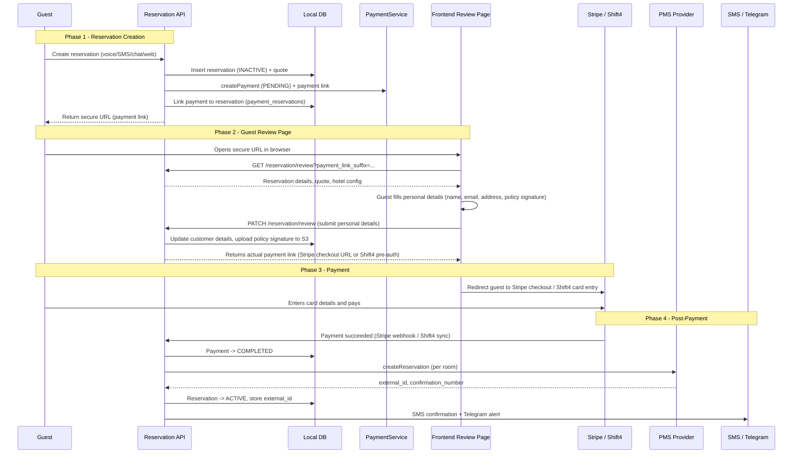
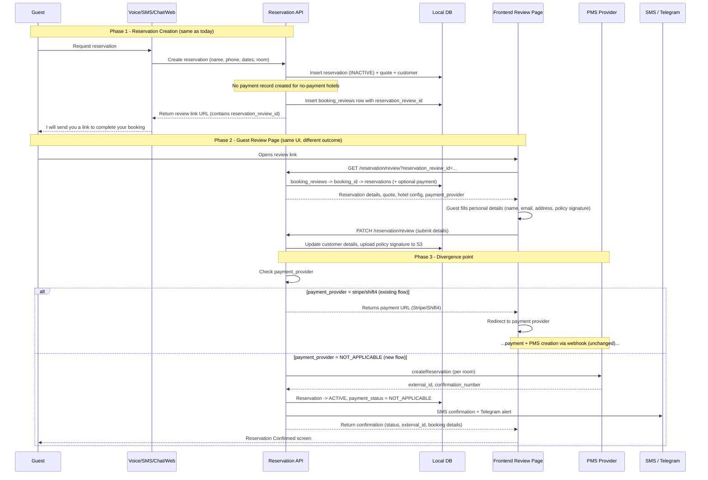
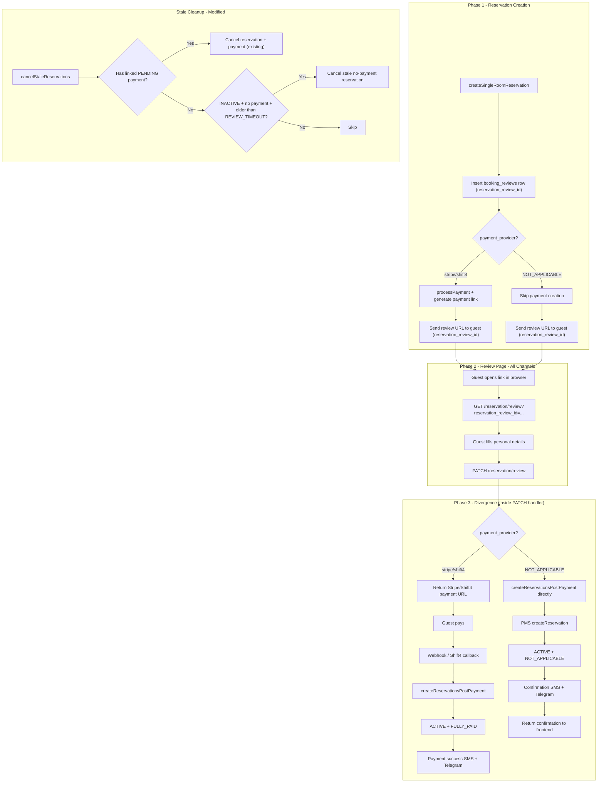

# No-Payment Reservation Flow Design

## Current Architecture

Today, every direct reservation follows a **pay-before-PMS-confirm** pattern with a guest review step in between:




### The Review Page Flow in Detail

The review page is a critical intermediate step between reservation creation and payment:

1. `**GET /reservation/review**` (`getReservationDetailsByPaymentLinkSuffix` at [roomReservationRouter.ts:51-54](websocket-server/src/router/roomReservationRouter.ts)) -- Loads reservation details, quote totals, hotel config, and validates room availability. The frontend renders a form for the guest to enter/confirm their personal details.
2. `**PATCH /reservation/review**` (`updateDataBeforePayment` at [roomReservationRouter.ts:46-49](websocket-server/src/router/roomReservationRouter.ts)) -- The guest submits their details (first name, last name, email, phone, address, billing address, optional policy signature). The service at [roomReservationService.ts:4061](websocket-server/src/services/roomReservation/roomReservationService.ts):
  - Updates the customer record with the submitted details
  - Uploads policy signature to S3 (if provided)
  - Re-validates room availability
  - **Stripe**: Returns the Stripe checkout URL (`STRIPE_PAYMENT_LINK_URL/{suffix}?prefilled_email=...`)
  - **Shift4**: Runs Shift4 pre-authorization, returns the Shift4 payment page URL + pre-auth response for the frontend's i4Go iframe
3. **Frontend redirects** the guest to the actual payment provider page to enter card details.

### Key coupling points between payment and PMS creation

1. `**createSingleRoomReservation`** ([roomReservationService.ts](websocket-server/src/services/roomReservation/roomReservationService.ts)) always calls `processPaymentForSingleRoomReservation` after inserting the reservation.
2. `**createMultiRoomReservation`** always calls `processPaymentForMultiRoomReservation`.
3. `**createReservationsPostPayment**` (line ~3450 in the same file) is the sole path to PMS creation and `ACTIVE` status -- only invoked from Stripe webhook success or Shift4 card-token success.
4. **The review page** (`GET` + `PATCH /reservation/review`) is tightly coupled to the payment link -- it looks up the reservation via `payment_link_suffix` and returns the provider's payment URL. No-payment reservations would have no payment link suffix, so this flow cannot be entered.
5. `**cancelStaleReservationsAndPayments`** assumes all `INACTIVE` reservations older than `PAYMENT_TIMEOUT` are stale and cancels them.
6. `**ReservationPaymentStatus`** has no concept of "not applicable" -- every reservation starts as `PENDING`.
7. `**payment_provider**` on the `hotels` table is an enum of `stripe | shift4 | unknown` -- no explicit "none" option.

---

## Proposed Flow: No-Payment Reservations

The review page is maintained for **all channels**. The guest always receives a link to the review page where they fill in their personal details (name, email, address, policy signature). The voice agent should not be burdened with collecting all of this over the phone.

The major difference from the current flow is what happens **after the guest submits their details** on the review page:

- **Payment-required hotels (existing):** `PATCH /reservation/review` returns a Stripe/Shift4 payment URL. Frontend redirects to payment. PMS creation happens after payment succeeds.
- **No-payment hotels (new):** `PATCH /reservation/review` creates the PMS reservation directly and returns a confirmation. Frontend shows "Reservation Confirmed" screen. No payment redirect.




### Key design principle

The flow is v**ery similar** up to the `PATCH /reservation/review` submission. The major divergence happens inside the backend after the guest's details are saved:

- **With payment:** Return payment URL (existing behavior)
- **Without payment:** Create PMS reservation inline, return confirmation (new behavior)

---

## Impact Analysis

### 1. Database / Enums


| Area                                                                                                                        | Impact        | Details                                                                                                                                                                                                                                                                                                                                                                                       |
| --------------------------------------------------------------------------------------------------------------------------- | ------------- | --------------------------------------------------------------------------------------------------------------------------------------------------------------------------------------------------------------------------------------------------------------------------------------------------------------------------------------------------------------------------------------------- |
| `PaymentProvider` enum ([enums.ts](websocket-server/src/types/enums.ts))                                                    | **Modify**    | Add `NOT_APPLICABLE = 'not_applicable'`. This is the sole toggle for no-payment hotels -- no separate `payment_required` flag. The existing `UNKNOWN` value is reserved for external/synced reservations where the provider is genuinely unknown (e.g., StayNTouch sync). When a hotel later enables payments, `payment_provider` is updated from `NOT_APPLICABLE` to `stripe` or `shift4`. |
| `ReservationPaymentStatus` enum ([ReservationPaymentStatus.ts](websocket-server/src/dtos/enum/ReservationPaymentStatus.ts)) | **Modify**    | Add `NOT_APPLICABLE = 'NOT_APPLICABLE'` for reservations that never require payment. `NOT_APPLICABLE` is a **fully terminal state** with no outgoing transitions -- no payment operations (manual charge, auto-charge, mark-payment-collected) are allowed on these reservations.                                                                                                             |
| `payment_reservations` junction table                                                                                       | **No change** | No rows will ever exist for no-payment reservations.                                                                                                                                                                                                                                                                                                                                          |
| `payments` table                                                                                                            | **No change** | No payment rows created for no-payment reservations, ever.                                                                                                                                                                                                                                                                                                                                    |
| `reservations` table                                                                                                        | **No change** | No schema change needed.                                                                                                                                                                                                                                                                                                                                                                      |
| `booking_reviews` table                                                                                                     | **New**       | New table that decouples the review page lookup from the `payments` table. Used for both payment and no-payment reservations. See schema below.                                                                                                                                                                                                                                               |


`**booking_reviews` table schema:**

```sql
CREATE TABLE booking_reviews (
  id                    UUID PRIMARY KEY DEFAULT gen_random_uuid(),
  reservation_review_id VARCHAR(64) NOT NULL UNIQUE,  -- 10-digit number for new rows; backfilled rows may contain Stripe URL suffixes
  booking_id            VARCHAR(32) NOT NULL,          -- e.g. "BK12345" (common prefix in case of multi-room)
  hotel_id              UUID NOT NULL REFERENCES hotels(id),
  created_at            TIMESTAMPTZ DEFAULT NOW()
);

CREATE UNIQUE INDEX idx_booking_reviews_reservation_review_id ON booking_reviews(reservation_review_id);
CREATE INDEX idx_booking_reviews_booking_id ON booking_reviews(booking_id);
```

- `**reservation_review_id**`: For newly created reservations, this is a unique 10-digit number. For Shift4 hotels, this is the **same value** as the Shift4 invoice ID (`payments.payment_link_id`) -- they are generated together and kept in sync. This means the Shift4 card-token endpoint can look up the payment using this same ID. For backfilled rows, it matches the existing URL suffix: Shift4 uses `payments.payment_link_id` (already a 10-digit invoice ID); Stripe uses the last path segment of `payments.payment_link` (e.g., `https://buy.stripe.com/live_abc123XYZ` -> `live_abc123XYZ`). The column is `VARCHAR(64)` to accommodate Stripe suffixes from the backfill.
- **One row per booking**: Multi-room reservations (e.g., `BK12345_1`, `BK12345_2`) share a single `booking_reviews` row keyed by the parent `booking_id` (`BK12345`).
- **Populated for all reservations**: Both payment and no-payment reservations create a row here. This unifies the review page lookup path.
- **Backfill**: Existing `INACTIVE` reservations with active payment links get `booking_reviews` rows. The `reservation_review_id` is set to the same value currently used as the URL suffix: for Shift4, this is `payments.payment_link_id` (already a 10-digit invoice ID); for Stripe, this is the last path segment of `payments.payment_link` (e.g., `https://buy.stripe.com/live_abc123XYZ` -> `live_abc123XYZ`). Note: Stripe suffixes are not 10-digit numbers -- `reservation_review_id` column should be `VARCHAR` to accommodate both formats during backfill, even though new IDs going forward will always be 10-digit numbers.

### 2. Hotel Configuration


| Area                                                                                               | Impact     | Details                                                                                                                                                                                                                                                                                                     |
| -------------------------------------------------------------------------------------------------- | ---------- | ----------------------------------------------------------------------------------------------------------------------------------------------------------------------------------------------------------------------------------------------------------------------------------------------------------- |
| `hotels.payment_provider`                                                                          | **Modify** | For no-payment hotels, set to `NOT_APPLICABLE`. This is the sole toggle -- no separate `payment_required` flag. When the hotel later enables payments, update to `stripe` or `shift4`. The existing `UNKNOWN` value remains reserved for external/synced reservations (e.g., StayNTouch sync uses `PaymentProvider.UNKNOWN` for payment records created from PMS webhooks). |
| `PaymentConfiguration` ([hotelConfiguration.ts](websocket-server/src/types/hotelConfiguration.ts)) | **No change** | No `payment_required` flag needed. `hotels.payment_provider = NOT_APPLICABLE` is the sole signal. |


### 3. Reservation Creation Service


| Method                                       | Impact        | Details                                                                                                                                                                                                                                                                                                                                                                                                  |
| -------------------------------------------- | ------------- | -------------------------------------------------------------------------------------------------------------------------------------------------------------------------------------------------------------------------------------------------------------------------------------------------------------------------------------------------------------------------------------------------------- |
| `createSingleRoomReservation` (~line 1264)   | **Modify**    | After inserting reservation + quote, always insert a `booking_reviews` row with a generated `reservation_review_id`. Then branch: if `payment_provider` is `stripe`/`shift4`, call `processPaymentForSingleRoomReservation` as before. If `NOT_APPLICABLE`, skip payment creation and return the review URL built from `reservation_review_id`. The reservation stays `INACTIVE` until the guest submits their details on the review page. |
| `createMultiRoomReservation`                 | **Modify**    | Same branching logic. One `booking_reviews` row per booking (parent `booking_id`).                                                                                                                                                                                                                                                                                                                       |
| `processPaymentForSingleRoomReservation`     | **No change** | Still used for payment-required hotels.                                                                                                                                                                                                                                                                                                                                                                  |
| `createReservationsPostPayment` (~line 3450) | **Reuse**     | This method creates PMS reservations and sets status to ACTIVE. It will be called from `updateDataBeforePayment` for no-payment reservations (after guest submits details on review page), in addition to being called from payment callbacks. No payment-specific logic inside it -- it only reads reservation/quote/customer data.                                                                     |


### 4. Stale Reservation Cleanup


| Method                                            | Impact     | Details                                                                                                                                                                                                                                                                                                                                                                                                                                                                                                                                                                                       |
| ------------------------------------------------- | ---------- | --------------------------------------------------------------------------------------------------------------------------------------------------------------------------------------------------------------------------------------------------------------------------------------------------------------------------------------------------------------------------------------------------------------------------------------------------------------------------------------------------------------------------------------------------------------------------------------------- |
| `cancelStaleReservationsAndPayments` (~line 3586) | **Modify** | The correct stale reservation logic is: an `INACTIVE` reservation is stale if it has been inactive for >= threshold time AND has no `COMPLETED` payment linked to it. The existing implementation finds stale reservations by joining through `payment_reservations` to `payments`, which means no-payment reservations (with no payment rows) are missed entirely. Add a **separate cleanup query** for no-payment reservations: find `INACTIVE` reservations with `payment_status = NOT_APPLICABLE` older than `REVIEW_TIMEOUT`. No payment check needed -- there are no payments to check. |


### 5. External Reservation Flows (PMS Lookup, Modify, Cancel)

External reservations (`type = EXTERNAL`) are looked up via PMS APIs (currently StayNTouch, to be extended to other PMS providers) and can be modified or cancelled directly through the PMS. These flows are **completely unaffected** by the no-payment changes.

| Flow | Impact | Details |
| --- | --- | --- |
| Lookup (`getReservationDetails` → `lookupPmsReservationsById`) | **No change** | DB + PMS merge lookup. Returns `payments: null` for PMS-only results. Does not check `hotel.payment_provider`. |
| Modify (`modifyExternalDirectReservation`, ~line 2929) | **No change** | Branches on `type === SessionType.EXTERNAL` before any payment logic. Calls PMS `modifyExternalDirectReservation` directly. The Shift4 auto-charge block (~line 3193) is unreachable for EXTERNAL. No DB update, no quote update, no payment processing. |
| Cancel (`cancelExternalDirectReservation`, ~line 1565) | **No change** | Branches on `type === SessionType.EXTERNAL` before `cancelPayments`. PMS cancel + Telegram alert only. No local DB status change, no refund automation. |
| Availability check for modification (`checkAvailabilityForModificationLite`) | **No change** | Branches on `SessionType.EXTERNAL`, uses `pmsService.getExternalModificationInfo`. Delta is handled manually by the hotel, not auto-charged. |
| Webhook sync (`StayntouchReservationSyncService`) | **No change** | Synced reservations use `PaymentProvider.UNKNOWN` (not `NOT_APPLICABLE`). Payment insert is currently disabled. When enabled, `UNKNOWN` signals that the provider is genuinely unknown for synced data -- distinct from `NOT_APPLICABLE` which means no provider is needed. |
| Dashboard/API exclusion | **No change** | Endpoints like `chargeReservationImmediately`, `setupAutoCharge`, `markPaymentCollected` already exclude EXTERNAL reservations (`SessionType.EXTERNAL` check at ~lines 5881, 5981, 6013). |

**Why no impact:** External flows branch on `reservation.type === SessionType.EXTERNAL` or `reservation.reservation_source`, not on `hotel.payment_provider`. The `payment_provider` field is copied into PMS-mapped DTOs for informational purposes only (via `mapHotelToDto`) but does not drive any external reservation logic. Adding `NOT_APPLICABLE` to the `PaymentProvider` enum introduces no new code paths for external reservations.

**`UNKNOWN` vs `NOT_APPLICABLE` distinction:**
- `UNKNOWN`: Used for external/synced reservations where the payment provider is genuinely unknown (e.g., StayNTouch webhook sync creates payment records without knowing whether the guest paid via Stripe, card-on-file, cash, etc.)
- `NOT_APPLICABLE`: Used for hotels that do not require payments at all. No payment records are created. The distinction is semantic: "we don't know" vs "there isn't one."


### 6. Payment Webhook / Shift4 Token Handlers


| Method                                                                                                                           | Impact        | Details                                                                                    |
| -------------------------------------------------------------------------------------------------------------------------------- | ------------- | ------------------------------------------------------------------------------------------ |
| `handlePaymentIntentSucceeded` ([stripeWebhookService.ts](websocket-server/src/services/stripe/webhook/stripeWebhookService.ts)) | **No change** | Only triggered for Stripe payments -- no-payment reservations never produce Stripe events. |
| `submitShift4CardTokenAndCreateReservations` ([roomReservationRouter.ts](websocket-server/src/router/roomReservationRouter.ts))  | **No change** | Only called for Shift4 payments.                                                           |


### 6. Review / Payment Link Flow

This is one of the most impacted areas. The review page lookup is being rewired from `payments`-based to `booking_reviews`-based for all reservations (both payment and no-payment).


| Method                                                                                                                                            | Impact                            | Details                                                                                                                                                                                                                                                                                                                                                                                                 |
| ------------------------------------------------------------------------------------------------------------------------------------------------- | --------------------------------- | ------------------------------------------------------------------------------------------------------------------------------------------------------------------------------------------------------------------------------------------------------------------------------------------------------------------------------------------------------------------------------------------------------- |
| `getReservationDetailsByPaymentLinkSuffix` ([roomReservationService.ts](websocket-server/src/services/roomReservation/roomReservationService.ts)) | **Rewrite**                       | Rename to `getReservationDetailsByReviewId`. Lookup changes from `paymentService.findPaymentWithReservationsByPaymentLinkSuffix(suffix)` to `bookingReviewRepository.findByReservationReviewId(id)` -> `reservationRepository.findByBookingId(booking_id)` -> optionally load linked payment via `payment_reservations`. The query param changes from `payment_link_suffix` to `reservation_review_id`. |
| `updateDataBeforePayment` ([roomReservationService.ts:4061](websocket-server/src/services/roomReservation/roomReservationService.ts))             | **Rewrite**                       | Rename to `submitReviewAndProcessReservation`. Lookup changes to use `booking_reviews`. After updating customer details, branch: if payment exists, return Stripe/Shift4 payment URL (existing). If no payment, call `createReservationsPostPayment` directly and return confirmation data.                                                                                                             |
| `findPaymentWithReservationsByPaymentLinkSuffix` ([paymentService.ts](websocket-server/src/services/payment/paymentService.ts))                   | **No longer used by review page** | The review page now looks up via `booking_reviews`. For Shift4 hotels, the `reservation_review_id` in `booking_reviews` is the same value as the Shift4 invoice ID (`payments.payment_link_id`). The `POST /shift4/card-token` endpoint receives this ID from the frontend and can look up the payment by it directly via `paymentRepository.findByPaymentLinkId`. |
| `getSecurePaymentUrl` ([helper.ts](websocket-server/src/utils/helper.ts))                                                                         | **Modify**                        | Rename or refactor to `getSecureReviewUrl`. The URL now uses `reservation_review_id` from `booking_reviews` instead of deriving from `payments.payment_link`. Same URL structure: `{SECURE_URL}/{hotel_name_slug}/{reservation_review_id}`.                                                                                                                                                             |
| Router endpoints ([roomReservationRouter.ts](websocket-server/src/router/roomReservationRouter.ts))                                               | **Modify**                        | `GET /reservation/review` query param changes from `payment_link_suffix` to `reservation_review_id`. `PATCH /reservation/review` query param changes similarly. Same endpoints, new param name.                                                                                                                                                                                                         |
| Frontend review page                                                                                                                              | **Modify**                        | URL param changes. Must handle the no-payment response: after submitting guest details, the API returns a confirmation instead of a payment redirect. The frontend shows a "Reservation Confirmed" screen instead of redirecting to Stripe/Shift4.                                                                                                                                                      |


### 7. Notifications


| Area                             | Impact            | Details                                                                                                                                                                                                                                              |
| -------------------------------- | ----------------- | ---------------------------------------------------------------------------------------------------------------------------------------------------------------------------------------------------------------------------------------------------- |
| SMS on creation (CALL sessions)  | **Modify**        | Currently `sendPaymentNotifications` sends a payment-link SMS for CALL sessions. For no-payment reservations, send a **review link SMS** instead -- same URL pattern but messaging says "complete your booking" rather than "complete your payment". |
| SMS after review submission      | **New**           | After the guest submits details and PMS reservation is created, send a **booking confirmation SMS** (similar to `paymentSuccessSMSTemplate` but without payment details).                                                                            |
| Telegram after review submission | **New**           | Send a Telegram alert confirming the reservation was created and activated (similar to post-payment Telegram, but without payment amount fields).                                                                                                    |
| Post-payment SMS/Telegram        | **Not triggered** | No payment means no payment-success notifications are fired from webhooks.                                                                                                                                                                           |


### 8. API Response


| Area                                    | Impact     | Details                                                                                                                                                                                                                                                                                                                              |
| --------------------------------------- | ---------- | ------------------------------------------------------------------------------------------------------------------------------------------------------------------------------------------------------------------------------------------------------------------------------------------------------------------------------------ |
| `createSingleRoomReservation` response  | **Modify** | For all reservations, the response now includes a review URL built from `booking_reviews.reservation_review_id`. For payment reservations, this replaces the payment link URL. For no-payment reservations, the `paymentRecord` field would be null/absent. The reservation remains `INACTIVE` at this point (same as payment flow). |
| `updateDataBeforePayment` response      | **Modify** | For no-payment reservations, instead of returning `{ paymentLink }`, return confirmation data: `{ reservation_status: 'ACTIVE', external_id, external_public_id }`. The frontend uses this to show a confirmation screen.                                                                                                            |
| Voice agent / SMS agent prompt handling | **Modify** | The agent should say "I'll send you a link to complete your booking details" instead of "I'll send you a payment link". This is an AI prompt / dialogue flow change.                                                                                                                                                                 |


### 9. Reporting / Analytics


| Area                                            | Impact     | Details                                                                                                                                                                                                         |
| ----------------------------------------------- | ---------- | --------------------------------------------------------------------------------------------------------------------------------------------------------------------------------------------------------------- |
| `updateReservationPaymentStatusFromPaymentInfo` | **Modify** | Must handle cases where no payments are linked to a reservation. Currently sums all linked payments -- for no-payment reservations, it should retain `NOT_APPLICABLE` rather than computing from zero payments. |
| Any dashboards or reports                       | **Review** | Reports filtering by `payment_status = PENDING` to find unpaid reservations must exclude `NOT_APPLICABLE` to avoid false positives.                                                                             |


---

## Design Decision

**`hotels.payment_provider = NOT_APPLICABLE`** is the sole toggle for no-payment hotels. No separate `payment_required` flag is needed.

- `payment_provider` indicates which provider payments go through. When set to `NOT_APPLICABLE`, it means payments are irrelevant for this hotel -- we don't track a provider.
- The reservation creation flow checks `payment_provider`: if `NOT_APPLICABLE`, skip payment creation entirely. If `stripe` or `shift4`, proceed with payment as today.
- When a hotel later introduces a payment provider, `payment_provider` is updated from `NOT_APPLICABLE` to `stripe` or `shift4`. New reservations created after the change follow the standard payment flow. Old reservations (with `payment_status = NOT_APPLICABLE`) remain permanently locked out of all payment-related actions.
- `PaymentProviderFactory.getPaymentService()` must reject `NOT_APPLICABLE` with a clear error.
- The existing `UNKNOWN` value is unrelated -- it is used for external/synced reservations (e.g., StayNTouch sync) where the provider is genuinely unknown.

---

## Data Integrity: Toggling payment_provider Over Time

A hotel may start as no-payment (`payment_provider = NOT_APPLICABLE`) and later switch to payment-required (`payment_provider = stripe/shift4`), or vice versa. The design must ensure no data corruption in either direction.

### Scenario 1: Hotel switches from no-payment to payment-required

**What exists in the DB:**

- Reservations with `payment_status = NOT_APPLICABLE` and `status = ACTIVE`
- No rows in `payment_reservations` for these reservations
- No rows in `payments` for these reservations
- `booking_reviews` rows exist with `reservation_review_id` linked to these reservations via `booking_id`

**What must work correctly:**


| Operation                                           | Risk                                                                                                                | Mitigation                                                                                                                                                                                                                                                |
| --------------------------------------------------- | ------------------------------------------------------------------------------------------------------------------- | --------------------------------------------------------------------------------------------------------------------------------------------------------------------------------------------------------------------------------------------------------- |
| **New reservations**                                | None                                                                                                                | New reservations follow the payment flow. `payment_provider = stripe/shift4` is checked at creation time.                                                                                                                                                 |
| **Cancellation of old no-payment reservations**     | Cancellation flow may try to look up linked payments for refund                                                     | Guard cancellation/refund logic: skip refund when `payment_status = NOT_APPLICABLE`. No payment record exists, so any `LEFT JOIN` to `payments` returns null -- code must handle this gracefully.                                                         |
| **Modification of old no-payment reservations**     | Modification flow may try to compute payment differential or collect additional charges                              | Guard modification logic: skip all payment-related steps (differential calculation, additional charges, refunds) when `payment_status = NOT_APPLICABLE`. PMS modification (date changes, room changes) proceeds normally -- only the payment aspects are blocked. These reservations must never have payments attached even after the hotel enables a payment provider. |
| **Review page lookup**                              | Old no-payment reservations have `booking_reviews` rows                                                             | These reservations are already `ACTIVE` -- the review page would not be accessed for them. The lookup via `booking_reviews.reservation_review_id` would find them but availability validation would handle the already-active state.                      |
| `**updateReservationPaymentStatusFromPaymentInfo`** | Called on payment events; may be invoked for a reservation that has `NOT_APPLICABLE`                                | Guard: if current `payment_status = NOT_APPLICABLE`, preserve it unconditionally. No payment operations are allowed on these reservations.                                                                                                                |
| **Stale cleanup**                                   | Old no-payment ACTIVE reservations should not be touched                                                            | Stale cleanup only targets `INACTIVE` reservations. `ACTIVE` no-payment reservations are safe.                                                                                                                                                            |
| **Auto-charge / delayed charge**                    | `setupAutoCharge` ([reservationRouter.ts:38-41](websocket-server/src/router/api/reservationRouter.ts))              | Must reject with a clear error if any reservation in the booking has `payment_status = NOT_APPLICABLE`. No-payment reservations never have auto-charge configured, but the guard ensures the endpoint cannot be misused after the hotel enables payments. |
| **Manual charge**                                   | `chargeReservationImmediately` ([reservationRouter.ts:43-46](websocket-server/src/router/api/reservationRouter.ts)) | Must reject with a clear error if any reservation in the booking has `payment_status = NOT_APPLICABLE`. Payment cannot be collected on no-payment reservations even after the hotel switches to payment-required.                                         |
| **Mark payment collected**                          | `markPaymentCollected` ([reservationRouter.ts:33-36](websocket-server/src/router/api/reservationRouter.ts))         | Must reject with a clear error if any reservation in the booking has `payment_status = NOT_APPLICABLE`. Offline payment recording is not applicable.                                                                                                      |
| **Reporting / dashboards**                          | Queries filtering by `payment_status`                                                                               | Reports must treat `NOT_APPLICABLE` as a distinct state, not as "pending" or "unpaid". Queries like "find all unpaid reservations" should exclude `NOT_APPLICABLE`.                                                                                       |


### Scenario 2: Hotel switches from payment-required to no-payment

**What exists in the DB:**

- Reservations with `payment_status = FULLY_PAID / PARTIALLY_PAID` and linked payment records
- Reservations with `payment_status = PENDING` and `status = INACTIVE` (awaiting payment)

**What must work correctly:**


| Operation                            | Risk                                                                              | Mitigation                                                                                                                                                                                                                                                                                                                                                       |
| ------------------------------------ | --------------------------------------------------------------------------------- | ---------------------------------------------------------------------------------------------------------------------------------------------------------------------------------------------------------------------------------------------------------------------------------------------------------------------------------------------------------------- |
| **New reservations**                 | None                                                                              | New reservations skip payment. `payment_provider = NOT_APPLICABLE` is checked at creation time.                                                                                                                                                                                                                                                                  |
| **In-flight INACTIVE reservations**  | Guests who already received a payment link but haven't paid yet                   | Two options: **(a)** Let them complete payment normally -- the Stripe webhook / Shift4 handler will still process the payment and create the PMS reservation. **(b)** Cancel them and ask guests to rebook. **Option (a) is safer** -- honor in-flight payment links. The `payment_provider` change only affects new reservation creation, not in-flight payments. |
| **Refunds on old paid reservations** | Cancellation of paid reservations needs refund logic                              | These reservations have `payment_status = FULLY_PAID` and linked payment records. Refund logic works as before -- it reads from `payment_reservations` and `payments`. No change needed.                                                                                                                                                                         |
| **Stale cleanup**                    | In-flight INACTIVE reservations with payments should still be cleaned up normally | They have linked `PENDING` payments, so existing stale cleanup logic handles them.                                                                                                                                                                                                                                                                               |


### Design rules to enforce

1. `**hotels.payment_provider` is checked at reservation creation time.** It determines whether a payment record is created and whether a payment link or review-only link is returned. It does NOT retroactively affect existing reservations.
2. `**hotels.payment_provider`** indicates which provider payments should go through. For no-payment hotels, it is `NOT_APPLICABLE` -- payments are irrelevant, no provider is tracked. When a supported payment provider is later introduced, `payment_provider` is updated to `stripe` or `shift4`. New reservations follow the standard payment flow. Reservations created before (with `payment_status = NOT_APPLICABLE`) must never have any payment-related actions performed on them. `PaymentProviderFactory.getPaymentService()` must reject `NOT_APPLICABLE` with a clear error.
3. `**NOT_APPLICABLE` is a fully terminal payment status** -- no outgoing transitions. Once a reservation is created without payment, it can never have payments attached to it. The following operations must be blocked for `NOT_APPLICABLE` reservations:
  - `POST /:booking_id/charge` (`chargeReservationImmediately`)
  - `PATCH /:booking_id/auto-charge` (`setupAutoCharge`)
  - `POST /:booking_id/mark-payment-collected` (`markPaymentCollected`)
4. `**validPaymentPreStatus` map** should NOT include any transitions from `NOT_APPLICABLE`. The status is immutable.
5. **All payment-related code paths** that read from `payment_reservations` already use `LEFT JOIN` and handle null payment records. This must be verified for any new code.
6. **Payment operation guards** should check `payment_status = NOT_APPLICABLE` at the service layer (not just the controller) to prevent bypasses. Return a `BadRequestError` with a clear message like "Payment operations are not supported for reservations created without payment requirement".

---

## Proposed Changes Summary

### Unified flow (all channels)

The flow is the same for all channels. The branching happens only at `PATCH /reservation/review` submission time.




---

## Files to Modify


| File                                                                                                                                               | Change                                                                                                                                                                               |
| -------------------------------------------------------------------------------------------------------------------------------------------------- | ------------------------------------------------------------------------------------------------------------------------------------------------------------------------------------ |
| [websocket-server/src/types/enums.ts](websocket-server/src/types/enums.ts)                                                                         | Add `NOT_APPLICABLE = 'not_applicable'` to `PaymentProvider` enum for no-payment hotels                                                                                              |
| [websocket-server/src/dtos/enum/ReservationPaymentStatus.ts](websocket-server/src/dtos/enum/ReservationPaymentStatus.ts)                           | Add `NOT_APPLICABLE` value as terminal state (no outgoing transitions in `validReservationPaymentPreStatus`)                                                                         |
| [websocket-server/src/types/hotelConfiguration.ts](websocket-server/src/types/hotelConfiguration.ts)                                               | No change needed -- `payment_provider` on `hotels` table is the sole toggle                                                                                                          |
| [websocket-server/src/services/roomReservation/roomReservationService.ts](websocket-server/src/services/roomReservation/roomReservationService.ts) | Branch in `createSingleRoomReservation` and `createMultiRoomReservation`; modify stale cleanup filter; guard `updateReservationPaymentStatusFromPaymentInfo`                         |
| [websocket-server/src/services/roomReservation/roomReservationService.ts](websocket-server/src/services/roomReservation/roomReservationService.ts) | Modify `updateDataBeforePayment` (~line 4061) to branch: when `payment_provider=NOT_APPLICABLE`, call `createReservationsPostPayment` directly and return confirmation instead of payment URL |
| [websocket-server/src/services/roomReservation/roomReservationService.ts](websocket-server/src/services/roomReservation/roomReservationService.ts) | Rewrite `getReservationDetailsByPaymentLinkSuffix` -> `getReservationDetailsByReviewId` to look up via `booking_reviews.reservation_review_id`                                       |
| [websocket-server/src/services/roomReservation/roomReservationService.ts](websocket-server/src/services/roomReservation/roomReservationService.ts) | Rewrite `updateDataBeforePayment` -> `submitReviewAndProcessReservation` to look up via `booking_reviews`, then branch on payment existence                                          |
| [websocket-server/src/controller/roomReservationController.ts](websocket-server/src/controller/roomReservationController.ts)                       | Update controller methods and query param validation for `reservation_review_id`                                                                                                     |
| [websocket-server/src/utils/helper.ts](websocket-server/src/utils/helper.ts)                                                                       | Refactor `getSecurePaymentUrl` -> `getSecureReviewUrl` to build URL from `reservation_review_id`                                                                                     |
| New: `websocket-server/src/repositories/BookingReviewRepository.ts`                                                                                | New repository for `booking_reviews` table: `create`, `findByReservationReviewId`, `findByBookingId`                                                                                 |
| New: `websocket-server/src/models/BookingReview.ts`                                                                                                | New model type for `booking_reviews` table                                                                                                                                           |
| [websocket-server/src/services/roomReservation/roomReservationService.ts](websocket-server/src/services/roomReservation/roomReservationService.ts) | Add `NOT_APPLICABLE` guard in `markPaymentCollectedOffline`, `setupAutoCharge`, and `chargeReservationImmediately` -- reject with `BadRequestError`                                  |
| SMS/notification templates                                                                                                                         | New confirmation-only templates (no payment details)                                                                                                                                 |
| Migration 1                                                                                                                                        | Create `booking_reviews` table with `reservation_review_id` (unique 10-digit number), `booking_id`, `hotel_id`                                                                       |
| Migration 2                                                                                                                                        | (Removed -- no `payment_required` flag needed. `hotels.payment_provider` is the sole toggle.)                                                                                        |
| Migration 3 (data)                                                                                                                                 | Backfill `booking_reviews` rows for existing `INACTIVE` reservations with active payment links                                                                                       |
| Frontend (review page)                                                                                                                             | Handle new response shape from `PATCH /reservation/review` -- show confirmation screen instead of redirecting to payment provider when `payment_provider=NOT_APPLICABLE`             |


---

## Edge Cases to Address

1. **Cancellation of no-payment reservations:** No refund is needed. The cancellation flow should skip refund logic when `payment_status = NOT_APPLICABLE`.
2. **Modification of no-payment reservations:** PMS modification proceeds normally. No payment differential to calculate.
3. **Converting no-payment to paid later:** If a hotel later enables payment, existing `NOT_APPLICABLE` reservations should not be retroactively charged. New reservations would follow the payment flow.
4. **Error during PMS creation on review submission:** Unlike the payment flow (where money is already collected), a PMS failure here has no financial exposure. The reservation stays `INACTIVE` / moves to `FAILED`. Telegram escalation should still fire. The frontend should show an error message and allow the guest to retry.
5. **Stale cleanup for no-payment reservations:** No-payment reservations sit as `INACTIVE` while awaiting review page submission (same as payment reservations awaiting payment). They need a configurable `REVIEW_TIMEOUT` for stale cleanup, which may differ from `PAYMENT_TIMEOUT`.
6. **Review page availability re-validation:** The review page currently validates availability via `pmsService.validateRoomAvailability` before allowing submission. This check must be preserved in the no-payment flow, especially since room availability could change between reservation creation and the guest completing the review form.
7. **Review page lookup via `booking_reviews`:** The review page lookup is unified via the `booking_reviews` table. Both payment and no-payment reservations are looked up by `reservation_review_id` (a unique 10-digit number). The ID must be unguessable to prevent unauthorized access to reservation details -- generated randomly, not sequentially.
8. **Race condition on review submission:** If the guest submits the review form twice quickly, `createReservationsPostPayment` could be called twice. Need idempotency -- check if reservation is already `ACTIVE` before creating in PMS.
9. **Review link SMS wording:** For CALL sessions, the SMS currently says "complete your payment". For no-payment hotels, the wording should be "complete your booking" or "confirm your reservation details".